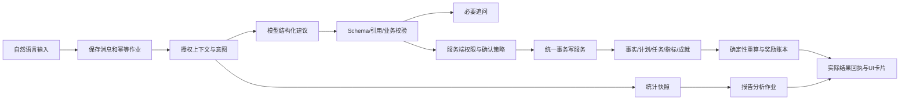

# v0.3 AI接口与数据契约

日期：2026-10-20。状态：待实现设计契约v0.3-design/1.0。继承v0.2-phase2/1.1；API继续使用/api/v1，不因应用版本改路径。精确机器格式见contracts/，引用/业务语义同时受本文约束。

2026-10-21实施补充：会话/规划相关端点已随第一阶段收口实现，其余仍是待开发范围。第二阶段在本契约上按[接口与集成交接要求](第二阶段接口与集成交接.md)完成12动作、报告/日程/报价与全链路代码；P2-00固化新响应/查询DTO和相应机器Schema。第三阶段集中真实供应商与应用API验证。

## 1. 从一句话到可信写入

模型不直连数据库，不拿Cookie或真实用户身份字段当参数。模型可请求受限查询工具，但每次重新检查授权；不能生成SQL、脚本、HTML或任意JSON Patch执行。

### 协议分层

| 层 | 版本/责任 |
| --- | --- |
| 客户端请求 | client-command/1.0；消息、来源面板、用户可见选择，不携带隐藏系统权限 |
| 模型输出 | ai-decision/1.0；意图、建议动作/追问和依据，不含应用状态/真实实体ID分配/确认令牌 |
| 服务端候选 | server-proposal/1.0；candidate_id、版本、风险、权限判定、预览摘要、实体前提、过期时间 |
| 应用回执 | application-receipt/1.0；实际ID映射、版本、影响、撤销能力和操作键；UI成功只能来自此层 |
| 报告快照/分析 | report-facts/1.0与report-narrative/1.0；数字由快照提供，分析与建议有来源 |
| 奖励报价 | reward-quote/1.1内部通道；普通动作没有奖励/余额/解锁字段 |

旧module_blueprint 1.0和action-proposal/1.0继续保留原意，不就地更换语义；新decision编译成有权限的领域命令。不能直接解除旧development蓝图的全部限制来冒充v0.3完成。

## 2. HTTP公共约定

现有会话与Origin校验保持。所有业务POST/PATCH使用Idempotency-Key=UUID；更新另有base_version或服务端来源前提。首次请求写入消息/作业后立即返回202，模型工作在后台，不长时间持有HTTP请求/用户写锁。

同用户、同路由、同键、同完整载荷返回相同受理对象；异包409。受理不表示已经写入业务事实。最终业务回执仍幂等；模型重试可多次计费，业务提交/报告发布必须只发生一次。

UUID、时间、时区和数值约定：标识UUID；发生时间RFC3339带偏移；日期ISO；时区IANA；业务小数用十进制字符串，integer字段用安全整数；null为未知，不能与0/空字符串混用。默认列表分页limit≤100；候选动作≤20、字符串/历史/工具结果均限长。

### 公共端点设计

下列端点均为待实现，不代表当前主环境已提供。

| 方法/路径 | 输入与结果 |
| --- | --- |
| POST /ai/conversations | `{entrypoint,title?}`→会话id/version；同一用户隔离 |
| GET /ai/conversations | 分页返回本人的会话摘要，不返回隐藏模型推理 |
| GET /ai/conversations/:id/messages | 游标分页，含用户消息和可见结果卡 |
| POST /ai/conversations/:id/messages | ChatMessageInput→202 `{run_id,message_id,status:"queued",operation_id}`；消息版本/指令见Schema |
| GET /ai/runs/:id | TurnResponse，区分回答、等待补问、等待确认、执行中、成功、失败/取消 |
| GET /ai/runs/:id/events | SSE，事件有单调event_id；断线可Last-Event-ID续读，GET作业始终是恢复依据 |
| POST /ai/runs/:id/clarifications | 原run版本、answer_text与question_id→同一用户意图的继续作业 |
| POST /ai/runs/:id/cancel | 版本→尽力取消；已提交事务不伪装回滚，返回实际状态 |
| GET /ai/proposals/:id | 服务端冻结候选、摘要、前提、缺项、过期状态 |
| POST /ai/proposals/:id/preview | version→服务器重新校验后的单张整组预览，不写业务实体 |
| POST /ai/proposals/:id/apply | ApplyInput→应用作业/回执；确认令牌仅在该候选需要确认时使用 |
| POST /ai/applications/:id/undo-preview | 当前版本→补偿计划；列出已被后续记录/奖励引用的部分 |
| POST /ai/applications/:id/undo | 预览版本/令牌→有审计的补偿，不删除历史账本 |
| GET /goals、GET /goals/:id | 目标、计划版本和关联对象投影 |
| GET /ai/config、GET /ai/usage | 脱敏连接/能力、剩余作业与用量；无API密钥 |
| GET/PATCH /ai/preferences | 自动执行偏好/可读模块/上限；base_version；模型不可修改自己的策略 |
| POST /reports/generate | ReportGenerateInput→202报告作业；自动关闭不妨碍手动请求 |
| GET /reports、GET /reports/:id | 报告身份/各修订、覆盖范围、来源和状态；不改事实 |
| GET /report-schedules | 每用户日/周/月各一条或关闭默认值 |
| PATCH /report-schedules/:kind | ReportScheduleInput，base_version；启用收费任务需匹配预览确认令牌 |
| POST /report-schedules/:kind/preview | 同配置不带令牌→自然语言范围、下次运行和预算摘要 |

前端标准卡片kind为answer/clarification/plan/record_receipt/report/report_schedule/error。前端只拿必要DTO，不默认下载模型原始输出、提示词或整个上下文。

SSE事件：run.accepted、run.started、assistant.delta、clarification.required、proposal.ready、application.committed、report.ready、run.failed、run.cancelled。assistant.delta只是未提交文本，不作为创建成功依据；提交后的实体变化以cursor/version刷新。

### 请求体补充

`contracts/public-api.schema.json`的$defs为精确请求体，root联合仅用于文档样例验证；实际路由只选择对应DTO，不允许某端点接受其他联合分支。

| DTO | 关键字段 |
| --- | --- |
| ConversationCreateInput | entrypoint、title|null |
| ChatMessageInput | schema_version、client_message_id、text、entrypoint、execution、selected_refs |
| ClarificationInput | run_version、question_id、answer_text |
| CancelInput | base_version |
| ProposalPreviewInput | candidate_version |
| ApplyInput | candidate_version、content_hash、confirmation_token|null；candidate_id来自URL且不得串用 |
| UndoInput | preview_version、confirmation_token |
| AiPreferencesInput | base_version、automatic_mode、readable_module_ids、自动配置/记录数量上限 |
| ReportSchedulePreviewInput | 日程配置和base_version，不带预览令牌 |
| ReportScheduleInput | 同配置+preview_token|null，开启/扩大收费任务校验确认令牌，关闭可为null |

同会话的client_message_id唯一，改文复用该ID拒绝；多个消息按服务端seq串行/排队，后来消息不静默改变正在应用的候选。追问回答必须指向同run/question/version。没有用户输入的消息接收时间由服务器记录，不信任客户端now。

## 3. 作业、候选、事务状态

作业：queued→running→needs_clarification/awaiting_confirmation/applying/completed；分支failed/cancelled。每次状态转移有version和事件；worker lease和尝试计数持久化。追问不重建同一批已完成事实。

候选：draft→validated→awaiting_confirmation/auto_authorized→applying→applied；另有invalid/expired/cancelled。服务端生成candidate_id和content_hash，模型不能设置。默认有效期24小时，任何来源版本/绑定/授权变化先重新预览；过期已成功操作仍可回放回执。

应用步骤：

1. 按用户写锁读取操作回执；已有成功先返回，包括旧无绑定指纹的已成功请求。
2. 校验候选归属/版本/content_hash、权限、确认状态、前提、缺项与动作边界。
3. 为本次所有新对象分配稳定UUID，建立local_ref→真实ID映射，拓扑排序；拒绝重复ref、循环依赖、越权existing引用和悬空依赖。
4. 全组验证模板字段、单位、规则、周期有效期、目标关联与锁价；跨对象约束通过后才写。
5. 在同一事务中通过可复用的领域写方法应用并一次重算，写修订/审计/奖励/事件/回执，再commit。
6. 模型网络调用和报告生成不在用户写锁内；事务失败回滚全部业务对象，返回可修复错误，不留下半组配置。

不能在一个外层事务里逐个调用会自行BEGIN/COMMIT的HTTP Service.mutate。需抽出`executeInTransaction`/`recompute`能力，复用v0.2校验；自动执行和手动高级表单走同一服务。

### 实体前提

context快照保存user_cursor、module/template/metric/profile/record版本、observation绑定指纹和引用白名单。候选显式使用的对象都在应用时重新核验；无关对象变化不必全盘失败。模型提供的base_version不作为权威，必须与服务器上下文绑定。

record.correct保持source_record_id/base_version；观测使用field_id/binding_fingerprint。同一次用户请求解析出的“今天/昨天”锚定接收时间与时区；重试不重新解释相对时间。复用既有记录/模板的所有字段兼容性仍必须验证。

### 撤销

新目标/任务可归档、停止未来生成；新记录使用现有软删除并重算；奖励以冲正记录处理，成就转复核。已有后续依赖或记录已改版本时不直接整批删除，展示补偿摘要。应用回执返回undo_available和原因，不承诺任何操作永久一键完全恢复。

## 4. 模型动作格式

权威设计Schema为`contracts/ai-decision.schema.json`。每个动作有action_type、local_ref、depends_on、evidence_refs、data；字段类型由动作判别联合确定，拒绝未知字段。引用采用`{kind:"existing",id}`或`{kind:"local",local_ref}`，引用类型由使用位置决定。

| 动作 | 主要数据与边界 |
| --- | --- |
| goal.create | 标题、原目标描述、模块引用、起止日、成功标准；属于配置/目标，不是事实 |
| module.create | 明确需要的新模块；优先复用四大模块 |
| record_type.create | 模块、名称、字段数组（已有七类型/单位/必填）；不能改旧模板暗中迁移事实 |
| metric.create | 模板、字段、单位、aggregation/window/timezone/精度；不能设置current_value |
| task_template.create | 模块/目标、类别、completion_mode、rule、颜色、有效期/星期/偏好时间；奖励另行报价 |
| task_template.change | 已有模板引用、明确changes；默认仅未来生效，不改锁定历史 |
| achievement_series.create | 模块/目标/模板、计量口径/过滤、history_policy、各门槛；无award_unlocked |
| record.create | 模板/模块、发生时间、字段值、可选任务引用、字段来源、估算注解；不得status=completed或balance |
| record.correct | 指定来源记录、字段修订、明确发生时间变更；必须整组预览确认，source版本来自候选前提 |
| profile.patch | 配置字段引用和值；观测变更编译到统一来源写入，派生字段拒写 |
| report.generate | 日/周/月、覆盖范围与模块；进入只读报告作业，不在业务事务内调用模型 |
| report_schedule.change | 独立日程配置；启用/扩大收费任务由服务器生成确认卡，不由模型声明已授权 |

clarification不作为可执行写动作；包含question、choices和blocking_fields。若有阻断缺项，该相互依赖写动作组不能auto_apply。单纯回答可有零动作；模型summary用于“拟执行”描述，最终“已记录/创建”文案由服务器回执渲染。

### 字段来源与估算

record的`provenance`逐字段说明source_type=user_statement/authorized_context/unit_conversion、evidence_ref、原文片段和原值/单位。实际values不接受ai_estimate；营养等估算放独立estimated_values，含value/unit/method/uncertainty/evidence_refs。精确字段不齐就追问/置null，不能把估算伪装成确认事实。

evidence_ref必须在授权消息/上下文集合，quote必须能在对应来源定位，不能由模型自写一段“用户说过”就算证据。record.create另含time_precision=instant/day/approximate、time_basis=explicit_datetime/explicit_date/relative_date/received_time/authorized_context。服务器从冻结消息锚解析并复核；仅有日期时归档timestamp不能作为精确时刻证据，分钟级任务条件不足就追问。

模板动态值字典还须按绑定模板Schema校验；JSON Schema允许scalar键值不代表任意业务键可写。AI不能通过换模板或新建“余额字段”获得实际钱包写权限。

## 5. 服务端候选和结果DTO

机器示例见examples/auto-applied-turn.json。TurnResponse的关键字段：

| 字段 | 语义 |
| --- | --- |
| id/version/status/operation_id | 服务端作业身份、单调版本和受理操作键 |
| conversation_id/message_id | 用户意图来源；不能从其他用户串用 |
| answer | 经校验/转义的可见文本；不是业务成功证明 |
| clarification | question_id/question/choices/blocking_fields；没有追问时null |
| proposal | candidate_id/version/status/summary/confirmation_required/expires_at；模型无法指定 |
| application | application_id/operation_id/cursor/id_map/affected_entities/undo_available；未提交时null |
| report | report_id/revision/status/coverage；仅报告场景 |
| error | code/message/retryable/retry_after_ms；无密钥/原始响应头 |

confirmation_required/auto_authorized及许可动作由服务器策略生成；客户端传`execution:"auto"`仅表达偏好，不能越过服务器判断。确认token绑定用户、候选摘要、版本、范围和到期时间；一次使用，不能确认后改包。

## 6. 报告请求、日程与快照

### 人工生成

ReportGenerateInput：kind=daily/weekly/monthly；period=current/previous/custom；custom有start_date/end_date（含），timezone、module_ids、force_new_revision。由服务器解析成UTC `[start,end)`和source_cutoff；本周期到现在的报告标partial=true。force只显式生成新分析版本，不修改统计事实；重复键返回同作业。

custom要求有效起止且start≤end，建议单次范围最多366天；非custom的start/end必须为null。模块范围空数组表示当前已授权全部模块，不能扩大授权。日程weekday仅周报非null、month_day仅月报非null；IANA时区、日期组合与预算确认需要路由领域校验，单独JSON格式验证不替代这些条件。

### 日程

ReportScheduleInput：base_version、enabled、local_time(HH:mm)、timezone、coverage=previous_complete/current_to_run、weekday(周报1–7否则null)、month_day(月报1–31否则null)、short_month_policy=last_day、catch_up=latest_only/skip、module_ids和preview_token|null。

日程只表达“什么时候做什么报告”，不接受任意cron、程序、外部URL或推送地址。默认日报08:00/周一08:00/月1日08:00且disabled；用户确认后持久化next_run_at。更改时区只影响未来，旧报告保持原周期。DST不存在本地时刻顺延到当天首个有效时刻；重复时刻只执行一次，保存logical_due_key。

### 事实包

report-facts/1.0由服务端构建：report_identity、kind、period_key、timezone、start_at/end_at、cutoff_at、partial、snapshot_cursor、模块范围、事实/配置版本引用、facts[]、coverage和warnings。每个fact有稳定fact_id、口径、精确值/单位、比较基期/覆盖率和来源列表。

content_hash为移除该字段后、对象键递归排序、无额外空白的UTF-8 JSON的SHA-256；业务小数为字符串。签名/身份保护由服务端承担，hash只用于版本/缓存一致性，不把自带hash当授权。

任务完成率分母按实例生成/有效性规则计算，取消/跳过/待复核单列；统计不同日数不等于记录条数。学习/训练合计来自未舍入事实；代币来自账本净额；估算营养单列。周月报告可用日汇总提效，但不能把长粒度平均再当合计或跨报告重复累加来源。

### 模型分析格式

`contracts/report-narrative.schema.json`只允许summary、highlights、concerns、suggestions和selected_fact_ids。分析条目带fact_refs与kind=observation/inference/suggestion，不含自填数值表。事实卡由服务器按fact_id填值；涉及定量表达使用fact引用占位，不接受模型另写统计金额。

发布前检查所有fact引用属于本快照、比较方向/定量占位合法、无缺失数据被当作0、无越权对象。自由文本的推断仍具有不确定性，明确标为分析/建议；不声称Schema能证明全部自然语言结论正确。报告建议不会自动进入执行器。

### 去重与修订

报告身份为用户+kind+周期边界+时区+模块范围+coverage，当前周期另含cutoff。每个修订保存不可变事实快照hash、提示词/模型/协议版本和来源。相同身份/快照/分析版本返回已有结果；明确重新生成可增加revision，旧版本保留。补录使旧快照标outdated，不能悄悄重写原报告。

日程实例唯一键含schedule_id、schedule_version、logical_due_key；报告发布幂等独立于模型尝试。开启/修改日程不能以换版本对同一已完成周期无限自动补生成。

## 7. 错误、取消与重试

| 错误 | 处理 |
| --- | --- |
| AI_NOT_CONFIGURED/FEATURE_DISABLED | 明确未连接/未开放；保留草稿与手动入口，不伪造回答 |
| AI_AUTH/AI_QUOTA | 配置/供应商余额问题，不循环重试；错误不泄露密钥 |
| AI_RATE_LIMIT/AI_TIMEOUT/AI_UNAVAILABLE | 有限重试，持久化attempt与预算；可取消，手动功能继续 |
| AI_INVALID_OUTPUT/AI_OUTPUT_TRUNCATED | 全包无写入；最多一次受限格式修复，仍失败则needs_fix |
| CLARIFICATION_REQUIRED | 返回最小必要问题和原候选状态 |
| INVALID_REFERENCE/INVALID_UNIT/INVALID_RULE | 只允许在授权集合和既有业务约束内修正，不静默换对象 |
| VERSION_CONFLICT/BINDING_CONFLICT/428 | 展示当前来源/绑定差异，保留草稿；显式采用后新操作 |
| IDEMPOTENCY_MISMATCH | 原键不可用于不同内容，先确认原结果，再分配新命令 |
| AI_BUDGET_EXCEEDED | 本地预算拒绝新调用，展示剩余/重试时间；不能自动切贵模型 |

客户端超时不意味着服务器未提交；只读查询run/application确认。取消不回滚已提交业务事务，撤销走补偿。供应商网络结果未知可能已计费；有限重试能保证业务不重复，不能保证外部计费exactly-once。

## 8. DeepSeek接入核对

2026-10-20核对官方资料：

- JSON Output需response_format=json_object、提示中明确JSON并给格式示例；存在空内容/截断情况，因此仍要本地验证和失败处理。[官方JSON Output](https://api-docs.deepseek.com/guides/json_mode/)
- Tool Calls由应用执行工具；strict为Beta，有独立入口及Schema子集约束，不能把完整业务Schema原样发送就假定支持。[官方Tool Calls](https://api-docs.deepseek.com/guides/tool_calls/)
- 模型能力和标识按模型列表/部署配置解析，不沿用旧适配器硬编码名称。[官方模型列表](https://api-docs.deepseek.com/api/list-models/)
- 稳定前缀可利用供应商上下文缓存，缓存命中不保证，不能代替本地权限与上下文控制。[官方Context Caching](https://api-docs.deepseek.com/guides/kv_cache/)

第一条实现路径建议延续Chat Completions+JSON Output+本地Schema；Tool Calls仅暴露受限查询和submit_proposal，不直接暴露数据库写。strict作为能力协商后增强：将canonical Schema编译为供应商子集（可选字段、动态values字典等需转换/按模板实例化），并在本地执行完整校验。本文JSON Schema是应用契约，不声称已做供应商在线兼容实测。
