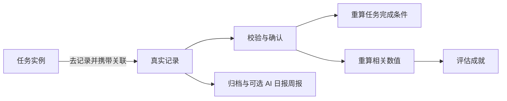

# 人生面板：产品设计文档 v0.2

**日期：2026-10-19｜状态：产品定义稿，供界面设计与开发使用**  
**本次范围：五个独立面板、四个默认模块、自定义模块、任务与记录联动、DeepSeek 生成内容的标准格式和自动填充。首页内容区保持空白。**

本版承接原 PRD 和技术方案；页面结构、模块体系及 AI 内容填充方式，以本版的新需求为准。VPS 自托管、多端同步、离线记录、独立 API 和长期数据保留沿用已有技术方向。本次没有开发、部署网站，也没有调用付费 API。

## 01. 产品定义

产品采用游戏面板的组织方式，让用户能够分别查看要做什么、发生了什么变化、取得了哪些成果，以及实际留下的记录。游戏感主要体现在界面结构、进度呈现和成就反馈，不把个人价值压缩成一个分数。

两个维度必须分开：

- **面板是操作入口：**任务面板、数值面板、成就面板、记录面板、设置面板。
- **模块是内容归属：**学习与发展、饮食与锻炼、财富与收获、娱乐和交际，以及将来创建的新模块。

同一个模块拥有自己的任务、数值、成就和记录模板。这些内容分别出现在对应面板中，通过关联关系连接，不需要为一个模块再建一套独立网站。

例如“学习与发展”可以同时包含任务“完成一次 Python 练习”、数值“本周学习分钟数”、成就“首次完成实践记录”和记录模板“学习记录”。任务点击“去记录”后，打开已经带上任务关联的学习表单；保存后，由系统按规则更新任务和数值，判断成就。

## 02. 信息架构与首页

### 2.1 主导航

桌面端：固定侧边导航或窄栏导航。手机端：顶部当前面板标题，底部五个面板入口；首页通过标志或独立入口访问，不为放入首页而挤压主要五个按钮。模块筛选在面板内部完成。

```text
首页（空白）
任务面板
数值面板
成就面板
记录面板
设置面板
```

建议路由：

| 页面 | 路由示意 |
| --- | --- |
| 首页 | `/` |
| 任务面板 | `/tasks` |
| 数值面板 | `/metrics` |
| 成就面板 | `/achievements` |
| 记录面板 | `/records` |
| 设置面板 | `/settings` |

每个业务面板支持 `module_id` 等筛选参数；详情有稳定对象 ID。名称和路由均为产品约定，实施时可以细化。

### 2.2 首页留空的明确范围

登录后的首页只保留通用导航外壳，**主内容区域不放欢迎语、汇总卡片、今日任务、数值概览、AI 对话框、占位文案或示例数据，也不自动跳转到任务面板。** 登录和初始化属于独立流程，完成后仍可以进入空白首页。

首页留作后续设计；本版不预留看得见的占位组件。其他面板有自己的正常空状态，这与首页留空不同。

### 2.3 面板独立性的定义

- 可以从导航直接进入任一面板，不需要先经过首页或另一个面板。
- 每个面板有独立列表、筛选、排序、详情、加载、错误与空状态。
- 各面板保存自己的筛选状态。跨面板跳转时显式携带模块与对象关联，不偷偷改变所有面板的全局筛选。
- 返回来源面板时恢复原筛选、滚动位置和选中项。
- 任务、记录、数值和成就共享同一份事实与关联，不各自复制数据。

## 03. 四个默认模块与自定义模块

### 3.1 默认模块

| 模块 | 典型记录 | 典型任务 | 典型数值 | 典型成就 |
| --- | --- | --- | --- | --- |
| 学习与发展 | 学习、课程、项目、阅读、作品与反馈 | 一次练习、完成一个作品步骤、处理课程事项 | 学习时长、有效实践次数、作品数 | 首次实践、第一份作品、累计完成若干次练习 |
| 饮食与锻炼 | 餐食、营养、训练组数、身体测量、恢复 | 一次训练、记录一餐、完成测量 | 已记录摄入、营养量、训练量、身体趋势 | 首次训练记录、建立可比训练记录 |
| 财富与收获 | 收支、账户、转账、项目付款、非现金收获 | 核对一笔交易、交付一次服务、整理预算 | 支出、自主收入、预算余额、可用现金 | 首笔自主收入、首次完成月度核对 |
| 娱乐和交际 | 游戏、影音、兴趣活动、朋友相处、活动体验 | 安排一次休息、体验兴趣、联系朋友 | 自愿记录的活动时长或次数、个人主观感受 | 第一次兴趣体验、留下一段值得保留的记录 |

上表为内容类型示例，不代表已经为用户创建目标或填入现实数据。默认只安装少量可用记录模板；任务、数值和成就可手动配置或通过 AI 生成。娱乐与交际中的时长和感受可关闭，不默认设置“交友数量”排名。

“财富与收获”中的非现金收获与金额分开：学到的经验、收到的反馈可以记录，但不能把它们随意折算为资产或收入。

### 3.2 模块对象

模块包含稳定 ID、名称、描述、图标、主题色、显示顺序、启用状态、来源和版本。名称可以修改，ID 不改变。四个默认模块与自定义模块使用相同能力接口，避免后来新增模块只能记文字、无法设置任务和成就。

状态包括启用、停用、归档。停用减少入口展示但保留数据；归档后停止新增周期任务、保留历史查询。模块删除必须展示影响范围；默认不级联删除历史记录。

### 3.3 自定义模块流程

设置面板 → 模块管理 → 新建模块 → 填名称与说明 → 手动配置或让 AI 生成配套内容 → 模块加入各面板筛选。

例如新增“语言学习”后，可同时获得练习记录模板、每周练习数值、口语任务和对应成就。首期支持配置型模块，不支持上传可执行插件、任意 SQL、脚本或页面代码。

系统内置能力处理营养、训练明细、账本等复杂领域；通用模块用表单字段与受限规则扩展。不能通过“自定义一个金额字段”就绕过正式账本的转账、余额和精度规则。

### 3.4 跨模块内容

每条事实记录有一个主归属模块，可以附加标签或关联其他领域。一次“朋友聚餐”可以包含一条餐食记录、一条支出记录与一条活动记录；如确实建立多个实体，界面明确显示关联，不把同一笔金额或同一份营养在两个模块中重复累计。

首期支持模块内的任务、数值和成就关联；跨模块成就和多来源复杂公式列为后续扩展。

## 04. 任务面板

### 4.1 页面布局

```text
任务面板                          ＋新建任务  ✦ AI 生成
[全部模块] [学习与发展] [饮食与锻炼] [财富与收获] [娱乐和交际]
[今日] [本周] [全部] [已完成]             筛选 / 排序

任务卡：完成一次 Python 练习
学习与发展 · 预计 20 分钟 · 待开始
完成要求：关联一条符合要求的学习记录
[去记录] [查看详情]

任务卡：整理本周计划
学习与发展 · 自主完成
[标记完成] [查看详情]
```

“AI 生成”只作用于用户选定的模块与范围；全部模块视图下先选择目标模块，不让模型自行决定向哪些模块批量写入。

### 4.2 任务字段

任务包含标题、说明、所属模块、优先级、计划与周期、完成方式、关联记录类型、验收规则、当前状态、来源。实际完成时间、证据与当前状态由真实操作产生，AI 配置不能直接填入。

周期任务分为“任务模板”和“某日／某周期任务实例”。今天训练与下周训练是不同实例，不能因为模板曾完成一次，就显示所有周期都完成。

### 4.3 三种完成方式

| 方式 | 按钮与行为 | 适用场景 |
| --- | --- | --- |
| 手动完成 | 直接标记完成，可写备注 | 整理计划等无需详细证据的任务 |
| 记录可选 | 可以完成，也可“完成并记录” | 想保留过程但不强制填写 |
| 必须关联记录 | 主按钮“去记录”；符合规则后完成 | 训练、学习实践、需要验证的交付 |

记录关联可指定一个模板，或从允许的模板中选择。验收规则首期仅支持已定义类型，如“存在有效关联记录”“指定数值字段达到门槛”，不接受 AI 生成任意表达式作为执行代码。数值门槛按单条有效关联记录判断，任一条满足即可；多条记录合计达标留作后续扩展。

### 4.4 任务到记录的跳转

任务按钮 → 打开记录面板中的创建页／抽屉，携带：模块 ID、记录模板 ID、任务实例 ID、返回地址。预填关联信息、用户当地日期与任务标题；**不预填实际学习时长、金额、训练量或“已经完成”等事实。**

保存时校验模板、必填字段、记录状态和验收条件，并保存任务—记录关联。可以从已有记录中选择，但必须符合时间、类型、模块与实例约束；不把上周记录无提示用于今天任务。

记录不达标时照常保存实际内容，任务显示部分进展或仍待完成，并说明差在哪。例如要求至少 10 分钟而实际完成 5 分钟，不能强迫用户填成 10 分钟。

### 4.5 状态与更改

任务状态：待开始、进行中、部分完成、完成、跳过、取消；周期模板另有启用与暂停。

任务规则修改默认只作用于之后的实例。历史实例保留完成时规则版本。删除或修改唯一完成证据时重新判断，显示“完成依据变化，待复核”，不静默维持错误完成状态，也不删除已经发生的真实记录。

## 05. 记录面板

### 5.1 页面功能

记录面板是实际发生事项的入口，支持按模块、日期、模板、标签与任务筛选；列表或时间线可切换。提供文字记录、通用表单与内置专业表单。手机优先让用户尽快记下实际内容，随后再补全。

通用字段：主模块、记录类型、发生时间、正文／字段值、附件、标签、关联任务、来源、确认状态。未知值保持未知；草稿、待确认提取和已确认记录分别显示。

### 5.2 记录模板

一个模块可以有多个模板。通用模板支持短文本、长文本、整数、精确小数、日期、布尔值、单选等受控字段；附件通过系统统一处理。

字段 key 一旦被数值或规则引用，不可因改中文名称而改变。新增可选字段可直接兼容；改字段类型、单位、精度或删除被引用字段，需要新模板版本或迁移。旧记录保存其 schema 版本，不用新模板重新解释所有历史内容。

### 5.3 两条录入路径

- **从任务录入：**带任务实例关系，保存后回到来源任务或选择继续记录。
- **直接录入：**先记录真实事项，可选关联当前适用任务；不为了凑任务完成率自动匹配所有任务。

如果用户选择把同一记录关联多个任务，明确显示关联范围。数值统计按唯一记录 ID 去重，不按任务关联条数累计。

### 5.4 AI 与记录事实

AI 可以生成记录模板，也可以将用户输入的文字提取成待确认记录草稿；两者是不同功能。提取流程必须保留原文、字段来源和不确定项。模型没有来源依据时不能“补齐”实际摄入、花费或完成情况。

从输入“今天学了一会儿 Python”可提取主题，但时长应为空；不能因为任务写了 20 分钟就记成实际学习 20 分钟。

### 5.5 离线和跨端状态

状态区分本机已保存、等待同步、已同步、冲突、需要处理。离线保存先保证记录与关联信息持久化；可以本地显示预计任务进展和成就，但标记待同步，以服务端规则确认后的状态为准。

## 06. 数值面板

### 6.1 数值分类

| 类型 | 来源 | 示例 | AI 可做什么 |
| --- | --- | --- | --- |
| 手动观测 | 用户或设备明确录入 | 体重、主观精力 | 生成定义与录入入口，不能生成当前实测值 |
| 记录聚合 | 对符合条件的记录计算 | 本周练习分钟数、活动次数 | 生成受支持的计算定义 |
| 专业指标 | 系统内置业务算法 | 预算余额、营养估计范围 | 选择已有算法和显示方式，不能生成任意算法绕过口径 |
| 目标与进度 | 已确认目标 + 实际数值 | 某作品阶段进度、学习目标进度 | 提出目标建议；与真实当前值分栏 |

默认不生成“智力 85”“魅力 72”“人生等级”等没有有效来源的属性。若未来增加游戏经验值，只能作为透明规则下的可选装饰数值，不替代收入、体重等实际数据，也不作为人格评判。

### 6.2 数值卡

每张卡显示名称、模块、当前值或未知、单位、时间窗口、更新状态、来源／计算说明。可选目标与趋势。点击卡片进入详情，再进入来源记录；从数值详情可以创建对应记录，不为更新一个数值制造另一份重复事实。

聚合首期支持计数、求和、平均和最新值，以及日、周、月、累计窗口。窗口使用用户时区；平均值显示有效样本数。未知不是零，部分记录不能伪装成全天总量。

### 6.3 目标与当前值

AI 自动生成“本周练习分钟数”的定义后，已有真实记录可立即计算；如果没有真实记录，显示“暂无数据”。目标可以作为 AI 建议单独标注，不能写入当前值。

金额、营养、负荷等有专门口径的指标，使用系统内置能力。健康与金钱相关目标不因生成成功自动替换用户现有目标；需要在对应目标设置中明确启用。普通新任务和新指标定义可按本版自动添加规则创建。

## 07. 成就面板

### 7.1 页面与对象

展示已解锁、进行中、未开始和需复核的成就，可按模块筛选。卡片包含名称、图标、说明、明确条件、当前进度、对应数值或任务、解锁时间与依据。

成就定义与成就授予记录分开。AI 能生成名字、说明和条件；真正的解锁由规则引擎根据真实记录计算，不能由 AI 直接输出 `unlocked=true`。

### 7.2 首期规则

首期支持单一数值达到门槛，例如累计 3 条有效练习记录。条件引用现有或同一生成包中的数值 ID；不接受任意代码。支持一次性成就与按统计周期重复达成，周期型以成就、用户和周期作唯一键。

成就定义新建时，明确是否允许追溯历史。**默认允许基于当前规则和已确认、未删除的历史记录计算进度**，但显示“根据历史记录解锁，评估于某日”，不编造过去的解锁日期。需要“从创建后开始”的成就，显式选择前向范围。

每日连续打卡、多条件逻辑和跨模块组合成就可后续扩展；首期不因为“像游戏”就强加连续天数要求。

### 7.3 反馈与纠错

解锁有轻量提示，动效和声音可关闭，支持减少动态效果。重复同步不重复授予和弹窗。修改或删除依据后，重新计算进度并标记原授予“需复核”；保留变更依据，避免悄悄改写历史。

图标和称号是展示，不赋予对真实账户、权限或预算的操作能力。自建或 AI 生成成就不可包含财务奖励自动付款等行为。

## 08. 设置面板

### 8.1 设置分组

| 分组 | 内容 |
| --- | --- |
| 模块管理 | 四个默认模块、自定义模块、名称图标颜色、顺序、启停、归档 |
| 内容配置 | 记录模板、任务完成方式、数值定义、成就条件、版本与依赖 |
| AI 设置 | DeepSeek 连接、模型、能力测试、生成范围、预算、数据使用范围 |
| 自动填充 | 默认生成行为、追加或更新策略、生成批次、撤销与重试 |
| 提醒与反馈 | 提醒时段、成就动效声音、静默模式；新增任务不自动打开通知 |
| 显示与隐私 | 深浅主题、游戏反馈强度、敏感数值隐藏、模块可见性 |
| 账户与数据 | 会话设备、同步状态、导出、删除、归档、恢复说明 |

### 8.2 内容依赖检查

删除模板前展示引用它的任务和数值；删除数值前展示引用它的成就。首期默认阻止破坏性删除，允许先停用。不能出现任务按钮跳到不存在的模板、成就引用已经删除的数值。

改模块归属时保留对象 ID，并检查目标模块能力与引用；默认不自动移动历史记录。正式账本和营养等受控模板不得通过普通模块管理破坏业务规则。

## 09. 面板之间的联动

### 9.1 联动规则

| 来源 | 目标 | 携带与行为 |
| --- | --- | --- |
| 任务“去记录” | 记录创建 | 主模块、模板、任务实例、返回位置 |
| 任务查看完成依据 | 记录详情 | 精确记录 ID，不生成副本 |
| 数值查看来源 | 记录筛选 | 模块、模板、字段与同一时间窗口 |
| 数值添加观测 | 记录创建 | 对应模板及字段；保存原始观测后再计算 |
| 成就查看进度 | 数值详情或对应任务 | 指向条件实际引用对象 |
| 成就查看解锁依据 | 记录／评估详情 | 评估版本、时间窗口及来源 ID |
| 记录关联任务 | 任务选择 | 只列可匹配的任务实例，用户选择关联 |
| 设置修改内容 | 对应面板详情 | 更新版本和依赖后返回，显示变化 |

### 9.2 一次记录的状态传播



服务端事务先保存真实记录与关联，再可靠触发派生重算；队列暂时延迟时显示“统计更新中”，不显示错误的最终值。原始记录不依赖 AI 服务可用性。任务完成、数值变化和成就通知均需幂等处理。

### 9.3 操作示例

1. 任务面板选择“完成一次练习”，点“去记录”。
2. 表单已关联当前任务，用户填写实际主题与时长。
3. 保存后进入本机持久状态，联网时同步。
4. 服务端校验通过，更新本次任务状态和相关统计。
5. 达到成就门槛时保存一次解锁，并可从成就卡点回真实依据。
6. 用户修改时长时，相关统计与完成依据一起重算。

## 10. AI 生成与自动填充

### 10.1 可以生成的内容

用户可以要求：为现有模块添加任务、记录模板、数值和成就；或根据一句描述新建模块并生成配套内容。也可以只选择其中一类。生成弹窗包含目标模块、自己的需求、允许参考的数据范围和本次生成内容类型。

输入示例：

> 在学习与发展里，给我设计一套每次十分钟起步的编程练习任务，配一个记录模板、学习时长统计和两个阶段成就。不要创建通知。

AI 接收允许引用的模块、模板、指标与版本清单，而不是靠名称猜 ID。上下文默认仅包含本次需求和相关配置；需要参考历史记录时，用户选择具体模块与时间范围。

### 10.2 两个入口行为

| 操作 | 结果 |
| --- | --- |
| 生成并添加 | 模型生成 → 服务端校验 → 同一事务创建新增配置和关联 → 自动出现在对应面板。无需逐项复制粘贴或再次逐项确认 |
| 仅预览 | 生成候选结果，可编辑；用户选择添加时再提交 |

默认生成行为是**追加新配置**。新增任务、模板、数值定义和成就规则可以直接启用；新增通知始终遵守原提醒设置，不能由模型自行打开。

AI 建议目标与实际数值严格区分。普通目标可作为“建议目标”显示，直到用户采用才参与正式目标进度；健康或金钱目标尤其不能借追加配置覆盖原有设置。

“生成并添加”是用户对这次范围内新增配置的操作授权；不是模型自行扩权。用户没有发起或预先启用的自动任务，不在后台随意创建更多模块和目标。

### 10.3 自动填充结果

成功后显示批次摘要，例如：“已添加到学习与发展：1 个记录模板、3 个任务、2 个数值、2 个成就”。提供进入对应面板、查看本次新增与撤销本次添加。

用户停留在原面板，不强制连续跳转。生成任务运行时可以切换面板，结果保存在服务器，手机返回后可查看状态。API 不可用时手动功能保持可用。

### 10.4 更新、重复与撤销

- 更新现有内容是独立操作，必须指明对象和基准版本，展示差异。首期 AI 协议只提供新增包，不夹带更新或删除指令。
- 相同生成任务重试、重复点击添加和网络重放，只产生一个已应用批次；重新生成是新候选，不叠加应用旧候选。
- 同名不自动视为同一对象。展示“可能重复”，由用户选择保留或重新生成，避免误把两个同名任务合并。
- 模块已归档或配置版本变更时，停止自动应用并说明冲突；保留候选，不静默写入错误模块。
- 撤销无使用记录的新增批次，可以撤回全部定义；一旦已被真实记录或其他配置引用，则改为停用／归档并提示范围，不能连同真实生活记录一起删除。

### 10.5 整包一致性

一套生成内容可以包含“模板 → 任务 → 数值 → 成就”的引用链。所有引用与规则验证通过后，才在一个事务里应用配置和 ID 映射。失败时不留下半套内容；不要出现成就已经可见、它依赖的数值还没有创建的情况。

配置应用后再计算历史进度。派生统计尚未完成时显示“计算中”，不能把尚未计算显示为零或已经解锁。

## 11. AI 标准格式：模块蓝图 1.0

### 11.1 配套交付文件

本版附带两个文件，可用于后续实现和模型提示：

- [AI 模块蓝图 JSON Schema](/Users/zhk/life_dashboard/design/人生面板_AI模块蓝图.schema.json)
- [AI 模块蓝图完整样例](/Users/zhk/life_dashboard/design/人生面板_AI模块蓝图.example.json)

Schema 是**应用服务端的规范格式**，不是已经跑通的 DeepSeek 请求参数。不同 API 接口可能只支持 JSON Schema 的子集，供应商请求层需做兼容转换或使用 JSON 模式回退，服务端规范始终保留完整验证。

首期协议名 `module_blueprint`，`schema_version=1.0`，每包只作用于一个模块。批量涉及四个模块时，编排为四个独立生成任务与独立应用结果，避免把一个超大包截断或隐藏部分失败。

### 11.2 顶层结构

| 字段 | 含义 |
| --- | --- |
| schema_version | 固定版本，未知版本拒绝应用 |
| kind | 固定 `module_blueprint`，区别于未来事实提取和报告协议 |
| module | 新建或扩展、目标模块 ID、本地引用、名称说明及图标主题色 |
| record_types | 新增通用记录模板与字段定义；专业内置模板通过允许的 ID 引用 |
| metrics | 新增数值定义、来源、聚合、窗口、单位及可选建议目标 |
| tasks | 新增任务、周期、优先级、完成方式和记录关联 |
| achievements | 新增成就定义、数值条件、重复策略与历史范围 |
| warnings | 需要用户了解的缺失条件或生成说明，不作为执行指令 |

数组可以为空，用于只生成某类内容；整包必须至少包含一项新增内容，或是在 `create` 模式下创建一个模块。后者允许用户先建空模块。

所有对象限制未知字段，文本长度、数组数量、图标、主题色与字段类型均有限制。结构中没有真实 records、当前 metric_value、任务 completed、成就 unlocked、user_id、密钥、SQL 或代码执行字段。

### 11.3 引用与归属

- 新对象用 `local:practice_log` 一类包内引用；服务端应用时分配正式 ID 并统一替换。
- 已有对象用 `id:真实UUID`，且必须出现在本次服务端允许引用清单中，验证用户归属、模块和能力。
- 所有新增对象属于当前包目标模块。扩展现有模块时，模块名称、图标和颜色只是用于核对，不自动修改现有模块属性。
- `module.mode=create` 要求目标 ID 为空；`extend` 要求目标 ID 与生成任务中选定模块一致。模型输出不能改变任务原先约定的目标。
- 不能仅因引用字符串长得像 UUID 就允许写入，格式合法和对象可访问是两层验证。

### 11.4 字段与规则约束

**记录字段：**稳定 key、显示名称、类型、是否必填、单位、选项和必要边界。枚举字段必须有有效选项；非枚举字段不携带伪选项；数值边界不能颠倒。首期蓝图新增模板只使用 generic 渲染器，不允许模型创造新表单执行组件。

**数值定义：**明确来源模板，聚合仅 `count / sum / avg / latest`，窗口仅 `day / week / month / all_time`。count 不引用某个数值字段；其余聚合须引用可用数值字段，单位兼容。来源默认是已确认、未删除、符合模板的唯一记录。

**任务关联：**`manual` 不需要记录绑定；`record_optional`、`record_required` 必须有合法绑定。完成验收仅支持“存在有效关联记录”或“指定数值字段达到门槛”。门槛使用同一模板字段的单位，不能把小时直接当分钟。

**周期：**无具体日期需求时默认 unscheduled；每周周期需要合法星期列表，一次性任务需要日期。时间均为当地时间并携带时区，AI 不能把没有提供的课表编成既定安排。

**成就：**首期只允许已知数值门槛，引用对象类型必须正确；按周期授予不能引用没有周期概念的累计数值。成就条件保存版本，禁止循环引用。

### 11.5 五层校验

1. **解析：**完整 JSON、输出未截断、无夹杂的执行指令。
2. **结构：**按配套 JSON Schema 验证版本、类型、必填、枚举、边界与未知字段。
3. **语义：**校验引用存在、引用对象类型、数值字段与单位、任务绑定和周期条件。
4. **权限与版本：**用户、目标模块、允许引用清单、模块当前版本、生成范围和预算符合本次请求。
5. **业务：**不越过账本和健康规则、不修改事实、不直接授予成就、不覆盖已有配置。

失败可把具体错误返回给模型做一次受控修复；仍失败就保留候选和错误，支持重新生成或手动编辑，不部分应用、不无限重试。只要能生成合法 JSON，不代表后四层验证已经通过。

### 11.6 样例解释

配套样例新增一个“语言学习”模块，含练习记录模板、每周分钟数、累计次数、一项需关联记录的任务和“迈出第一步”成就。

任务预期 10 分钟只用于说明与计划；实际分钟数由用户填写。若实际记 5 分钟，累计次数可以增加，首次有效记录成就可以达成，但“至少 10 分钟”的任务尚未完成。这体现了任务、数值和成就各按自己的规则工作，而非强制一同变成完成状态。

样例中的每周 30 分钟是建议目标，尚未采用时不进入正式目标进度。JSON 文件是示例配置，没有创建真实学习记录或实际启用任何模块。

## 12. DeepSeek 接入的产品要求

### 12.1 设置项

设置面板包含供应商 DeepSeek、API Key 配置状态、所选模型 ID、连接测试、结构化生成能力、预算限制、允许参考的数据范围与生成日志。密钥只保存在服务端，浏览器显示掩码和配置状态；不写入模块蓝图、导出包和普通日志。

模型 ID 可配置，实际列表和能力在接入时测试，不把某一代模型名称永久写死在产品规则里。第一版只要求完成文本结构化配置生成和文本日报周报；图片、语音能力独立验证，不预设所有 DeepSeek 模型都支持。

### 12.2 输出路径

截至本次查阅，DeepSeek 官方 Responses API 文档列出了 `text.format` 的 `json_object` 与 `json_schema` 输出格式；工具调用文档也列有 strict Beta 及其约束。因此接入时优先验证所选模型与接口的结构化输出能力；可用时传入兼容 Schema，不可用时用 JSON 模式与服务端完整校验。[Responses API](https://api-docs.deepseek.com/api/create-response/)｜[工具调用与 strict 说明](https://api-docs.deepseek.com/zh-cn/guides/tool_calls/)

**两类 API 的参数位置不能混用，供应商支持子集也不等于配套 Schema 可以原样提交。** 产品结果统一转成蓝图 1.0；DeepSeek 接口变化由模型适配层吸收，不改变各面板的数据结构。

不需要给模型开放数据库写工具。它只返回候选配置，业务服务完成验证、事务应用和权限检查。即使以后采用 function calling，也只接受受控蓝图提交接口，不开放任意 SQL 或文件操作。

### 12.3 生成任务与异常

生成状态：排队、生成中、校验中、已添加、待预览、需要修正、失败、已取消。界面显示实际状态，不用“正在思考”长期遮住失败。流式文字预览不是已应用内容，只有完整包验证通过才写入。

API Key 无效、额度不足、网络超时、模型不支持格式、输出截断和语义错误分别反馈。有限次数重试计入本次费用；取消尽量停止后续调用，但不能保证已经发生的供应商调用不计费。生成失败不影响手工记录和五个面板的使用。

### 12.4 日报周报的位置

保留原技术方案中的日报周报能力，作为**记录面板内的“AI 复盘”子视图**，不新增第六个业务面板，也不放到空白首页。支持按模块或跨四个模块查看，事实来源和权限边界仍按用户选择。

模块蓝图、事实提取和日报周报采用不同 kind 与 Schema。报告可以提出新的任务建议；只有用户点“添加为任务”，或预先明确启用对应自动规则，才进入任务面板，避免把分析文字当成已授权配置。

## 13. 视觉与交互方向

### 13.1 游戏感的默认表达

初版采用清晰的游戏菜单和状态卡：稳定的面板导航、模块图标与颜色、任务状态、数值卡、成就徽章、轻量解锁反馈。默认深色主题可切换浅色；字体优先可读中文，避免为了游戏风格大量使用难读像素字。

没有用户素材时使用统一图标，不自动生成复杂角色形象。首页不放角色属性页或等级。任务优先级与生活价值分开，不用高低颜色暗示某个人更优秀。

模块建议色：学习蓝、饮食锻炼绿、财富琥珀、娱乐交际紫；颜色可改，并有文字与图标共同区分。

### 13.2 手机操作

任务卡的“去记录”是明确主按钮。表单按手指操作设计，数字字段调出合适键盘，支持保留草稿和返回。保存后不连续弹出多层成就、统计和 AI 提示，避免阻断继续记录。

手机数值卡可纵向排列，成就使用紧凑网格，设置分组展开。筛选不占满首屏。深链接、浏览器返回和 App 未来的返回逻辑保持一致。

### 13.3 空状态

任务面板：提示创建任务或为当前模块 AI 生成；数值面板：提示添加数值定义或去记录；成就面板：提示配置成就条件；记录面板：提供新建入口。空状态不预填实际数据。

首页按需求完全空白，不能复用上述空状态组件。

## 14. 首期范围与后续扩展

### P0：本版必须实现的闭环

- 空白首页和五个可独立访问的面板。
- 四个默认模块，配置型自定义模块及启停归档。
- 手动任务、周期实例、三种完成方式和任务到记录的关联跳转。
- 内置基础记录模板与通用字段表单；实际记录与定义分离。
- count、sum、avg、latest 数值和明确时间窗口。
- 单一数值门槛成就、解锁依据和重复去重。
- DeepSeek 配置、模块蓝图 1.0、生成并添加、仅预览、错误反馈和批次撤销。
- 原有多端同步和离线状态；生成内容与真实记录都能在其他设备取得。

### P1：使用稳定后增加

跨模块成就、多个记录类型完成同一任务、复杂组合规则、AI 更新现有配置的差异预览、更多通用字段、语音和照片提取、批量导入、较复杂的成就外观。

日报周报沿用已规划的异步方案，可以与基础闭环并行开发，不作为模块自动填充的前置条件。长期语义检索按原技术方案分阶段加入。

### 暂不实现

公开排行榜、社交比较、自动付款奖励、任意代码插件、AI 自行授予成就，以及没有真实来源的人格属性评分。首页未来内容继续待定。

## 15. 验收标准

| 编号 | 场景 | 预期 |
| --- | --- | --- |
| P01 | 进入已登录首页 | 导航可用，内容区无卡片、文案、示例和自动跳转 |
| P02 | 直接打开任一面板链接 | 独立加载，不依赖首页先初始化组件 |
| P03 | 切换任务面板模块 | 只改任务面板筛选；返回原页面恢复视图 |
| P04 | 从任务进入记录 | 自动带上模块、模板与当前任务实例，实际数据留给用户填写 |
| P05 | 记录未满足门槛 | 真实保存，任务不伪装完成，解释差异 |
| P06 | 同一记录关联两项任务 | 数值按唯一记录计一次；任务各自判断 |
| P07 | 周期任务今天完成 | 不自动完成未来实例 |
| P08 | 删除唯一完成证据 | 任务、数值与成就重新评估并说明变化 |
| P09 | 新建自定义模块 | 各面板出现该模块筛选，可配置同类任务、数值、成就和记录 |
| P10 | 模块改名或归档 | ID 与历史关联保留，归档不继续创建新周期任务 |
| P11 | 成就条件满足 | 只授予一次，能查看规则版本、时间范围与来源 |
| P12 | AI 生成并添加整套内容 | 自动进入指定模块，引用正确，首页仍空白 |
| P13 | 模型返回合法 JSON 但引用不存在 | 拒绝应用，不留下半套对象 |
| P14 | 模型夹带 completed、unlocked 或真实 records | 未知字段或越权内容被拒绝，不产生虚假事实 |
| P15 | 同一个生成结果重复提交 | 同批次只应用一次，不重复创建任务与成就 |
| P16 | 生成期间模块被归档或版本变更 | 显示冲突并保留候选，不写错位置 |
| P17 | 撤销已经被真实记录引用的生成包 | 停用或归档配置，不级联删除真实记录 |
| P18 | DeepSeek 不可用或余额不足 | 生成明确失败，手动记录、查看和同步仍可用 |
| P19 | 本地离线录入后联网 | 记录与任务关联完整同步，不重复计数和重复解锁 |
| P20 | 查看 AI 日报周报 | 位于记录面板子视图，数字和引用可核查，不新增首页内容 |
| P21 | 配套 JSON 样例应用在测试环境 | 创建一个自定义模块及完整关联；无现实事实被自动填入 |
| P22 | 模板改字段名、类型或单位 | 展示依赖；改标签不改 key，破坏性修改有版本与迁移方案 |

## 16. 与技术方案的衔接

模块定义、记录模板、数值定义、成就定义及生成批次，作为 PostgreSQL 中的版本化配置对象；任务实例、实际记录、观测、统计快照与成就授予作为运行数据。通用字段可以采用受校验 JSONB，但财务、营养、训练等核心业务继续使用专门模型。

新增配置同样进入多端变更日志。AI 生成服务经过后台任务运行，应用时记录 generation_job_id、基准版本、原始输出摘要、校验结果、正式 ID 映射与应用回执。重复请求依赖服务端幂等，不依赖模型“每次输出一样”。

规则引擎、统计和成就评估在服务器执行确定性逻辑。浏览器可以预览结果，但不能靠直接改卡片数字更改事实。DeepSeek 只是首个适配器，未来更换模型不改变蓝图协议和面板结构。

本版已明确：页面骨架、内容归属、自动生成的对象范围、记录联动和验收规则。具体配色细节、完整记录字段清单和首批任务内容，可在后续原型阶段进一步细化；首页仍保持空白。

**交付核验：**配套蓝图样例已通过所用 Schema 约束子集的检查，以及 12 个结构／语义错误场景检查，包括虚构事实字段、直接解锁、失效引用、重复引用、错误单位和周期条件。未调用真实 DeepSeek API；上线仍需接入正式 JSON Schema 校验器，并验证权限、事务、幂等和实际模型兼容性。
