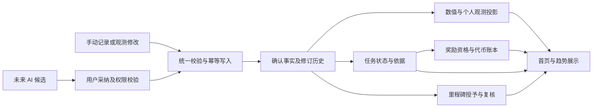

# 人生面板：应用 v0.2 需求文档

日期：2026-10-19  
文档状态：需求初稿，供评审与后续拆分任务；本轮不开发应用、不改数据库、不调用模型。  
适用版本：**应用 v0.2**。历史《产品设计文档 v0.2》是早期文档编号，不代表本应用版本；本文件不覆盖或改写它。

## 1. 版本目标与已确认决定

v0.2 将 v0.1 的手动五面板扩展为具有首页、周期任务、趋势、里程碑成就、代币钱包和个人信息详情的个人面板，并为 v0.3 在各处接入 AI 预留统一接口。

本轮用户已确认：

| 问题 | 决定 |
| --- | --- |
| “每月任务（季度委托）”的含义 | 按自然月执行，名称改为 **月常委托**；v0.2 不额外增加季度任务类别 |
| v0.2 尚未接入 AI 时如何发代币 | 使用**不可由用户手改的系统规则**；v0.3 改为 AI 定价，经服务端校验并锁定 |
| 3D 个人形象 | 本版只预留前端接入接口，不实现模型、动作、编辑器和兑换 |
| AI 开发边界 | v0.2 完成界面容器、上下文与动作协议预留；真实对话、生成、AI 记录/修改在 v0.3 实现 |

除上述确认外，下文具体奖励金额、额度和统计默认参数均为**建议初始值**，不是用户事实或已经生效的配置。开发前可统一调整；进入发布后按规则版本管理。

## 2. 版本范围

| 内容 | v0.2 交付目标 | v0.3 或更后续 |
| --- | --- | --- |
| 首页 | 标准布局、极简模式、个人信息/数值、任务与成就展示、趋势固定 | AI 真正回答；3D 模型/动作另立阶段 |
| 任务 | 主线、每日、周常、月常；周期实例；颜色和筛选；首页固定 | AI 生成任务、AI 奖励定价 |
| 数值 | 四时间范围折线图、可选粒度、按日均值聚合、异常点展示筛选 | AI 解释趋势、建议目标 |
| 成就 | 成就总数、同系列多门槛里程碑、证据与复核 | AI 生成成就系列 |
| 记录 | 保留可靠手动记录，增加 AI 记录容器/候选预览协议 | 对话抽取事实、批量候选与确认入库 |
| 设置/个人信息 | 四模块详情、自定义信息字段、手动保存与来源联动 | AI 从记录生成信息更新建议 |
| 代币 | 系统奖励规则、不可手改余额、发放/冲正账本、钱包展示 | AI 定价；兑换模型只留接口，本版不开发 |

延续本地 Docker、PostgreSQL、独立 API 和当前 Web 实现，不因版本增加自动引入新框架。多设备同步、PWA、正式账号、手机可信 HTTPS、VPS 部署和专业账本不自动纳入本版；原有代码与延期设计继续保留。

## 3. 全局信息架构与规则

导航仍为首页、任务、数值、成就、记录、设置。个人信息详情页从设置进入，也可点击首页个人信息区跳转。钱包从首页代币余额或个人信息页进入，不新增一级导航。

四个默认模块继续为：学习与发展、饮食与锻炼、财富与收获、娱乐和交际。自定义模块与默认模块拥有相同的任务、数值、成就、记录与个人信息扩展能力，不在前端写死只有四类。

所有时间均以用户设置的 IANA 时区计算，数据库保留绝对时间与业务周期。未知数据为 null，真实零单独呈现；示例、AI 建议和目标不能自动变成实际完成记录。可靠提交、幂等、版本冲突、修订与证据追溯继续适用。

## 4. 首页

### H01 标准模式

桌面采用主要内容区与辅助卡片区，手机按下表顺序纵向排列；此处定义信息结构，不冻结最终视觉尺寸。

| 区域 | 内容与操作 |
| --- | --- |
| AI 对话框 | 统一对话容器，支持未来携带当前页/模块/选定对象上下文；v0.2 不联网生成 |
| 个人形象 | 3D 渲染槽位的静态占位；模型与动作暂不可用，不显示会误导为已开放的编辑/兑换按钮 |
| 个人摘要 | 昵称、当前选定的个人信息、代币余额；点击进入详情或钱包 |
| 个人数值 | 用户固定的数值卡片，明确单位、统计周期和数据更新时间 |
| 数值趋势 | 用户从数值面板固定的折线图，复用同一统计口径 |
| 今日任务 | 当前自然日的每日委托，以及用户固定且当前有效的主线/周常/月常任务 |
| 近期成就 | 最近有效授予的成就，显示系列、门槛和时间，点击查看依据 |

默认展示最多 4 张数值卡、2 张趋势、5 项任务、3 项成就，其余提供“查看全部”；这些为建议默认，不限制业务数据数量。没有任务、数值或成就时给对应配置/记录入口，不生成虚构内容。

首页固定是指引用原对象，不能复制出独立任务或统计规则。原对象更新后同步刷新；被归档、删除或失效时显示必要提示并从有效摘要移出。用户固定顺序、显隐、图表范围等保存为用户偏好。

### H02 主页极简模式

设置 → 显示与首页 → **主页极简模式**，默认关闭。开启后：首页主内容区只保留一个水平居中、垂直居中的 AI 对话容器，隐藏个人形象、个人摘要、数值、趋势、任务和成就区。

通用导航保留，以便退出首页和关闭极简模式；AI 容器的状态提示属于容器本身，不额外增加首页卡片。手机软键盘展开后输入区仍需可见；减少动效遵循系统和用户偏好。

关闭极简模式恢复原卡片和固定顺序，不清空首页配置；切换模式不丢对话输入草稿，不触发模型调用或计费。

### H03 v0.2 的 AI 容器行为

v0.2 展示输入容器和“AI 将在 v0.3 开放”的清晰状态；允许保存/清除当前浏览器的待发送草稿，发送按钮禁用。不返回伪造回复，也不借用开发 mock 作为真实聊天。

首页与记录面板可共享未来会话 ID，但动作上下文不同：普通聊天不默认允许写记录。v0.3 的上下文读取范围和候选动作见第 11 节。

### H04 3D 形象前端接入预留

本版只定义可替换的 `AvatarRendererPort`，不选定或引入 3D 引擎，不制作模型、动作或资源编辑器。

| 接入项 | 预留约定 |
| --- | --- |
| 输入状态 | character_id、model_asset_ref（可空）、appearance_config、animation_state、状态版本 |
| 动作状态 | idle、greeting、celebrate、focus 等受控动作 ID；不执行来自用户或模型的脚本 |
| 生命周期 | mount、update、pause、dispose；极简模式隐藏时不加载资源并释放/暂停渲染 |
| 事件 | ready、error、interaction；可由已确认成就触发未来庆祝动作 |
| 显示环境 | 容器尺寸、减少动效、设备性能级别；加载失败回退静态占位 |

当前没有资源时 `model_asset_ref=null`，不得强制下载不存在的资源。个人信息与代币功能不能依赖 3D 渲染成功才可使用。

## 5. 任务面板

### T01 分类与周期

| 类别 | 展示名 | 周期与实例 |
| --- | --- | --- |
| 长期任务 | 主线任务 | 一个持续任务实例，可设截止日期；不自动每日重置 |
| 每日任务 | 每日委托 | 用户当地自然日，每日独立实例 |
| 每周任务 | 周常委托 | 周一 00:00 至下周一 00:00，每周独立实例 |
| 每月任务 | 月常委托 | 当月 1 日 00:00 至下月 1 日 00:00，每月独立实例 |

任务模板与任务实例分开。创建时默认从当前周期生效，不自动生成过去大量任务；未来实例可按需生成，但必须拥有唯一业务周期键，刷新、重启或重复生成不能产生同周期重复实例。长期任务完成后不自动变成新任务。

用户修改模板原则上只影响未来实例；当前实例的完成规则和奖励已锁定，必须明确选择是否调整当前未开始实例。已完成历史不追随模板新配置改写。归档模板停止后续生成，但保留历史。

用户更改时区后，已生成实例保留原周期/时区；未生成未来实例采用新设置。不能因切换时区重复生成、重置奖励或改变既有记录归属。

### T02 完成规则与状态

延续 manual、record_optional、record_required。周期任务除“单条记录达门槛”外，新增周期内累计规则：次数、不同自然日数、数值字段合计；配置界面明确区分单条门槛与周期累计。

例：每次学习不少于 10 分钟属于单条规则；一周学习 3 天属于不同自然日数；每周跑步 10 公里属于周期数值合计。每条事实在同一规则中只计一次，同一天多条记录只计一个有效日；草稿和软删除事实不计入。

周期累计默认纳入同模块、同模板且发生时间落在实例周期内的匹配确认记录，无需逐条手工绑定周常/月常；来源明细必须可回链。单条验收保留显式任务绑定。规则的纳入范围随实例锁定，不能在奖励发放后静默扩大。

周期内未完成显示待完成/进行中/部分完成；周期结束后显示已结束未完成，不自动挪进下一期。允许补录真实记录并重算完成状态；其代币资格按第 8 节判断。已取消/跳过任务不得通过补录重新完成。

手动完成提供明确的撤回操作并保留原因/历史，已发奖励随之冲正。同一条记录可以证明多个不同任务，各按各自奖励资格结算；同一任务不能因多条证据、撤回再恢复或重复提交多领。

### T03 颜色、筛选与固定

任务卡片可从色板选择颜色，也可使用通过校验的自定义颜色值；不可输入 CSS/HTML。颜色只用于视觉标识，不改变任务类别、难度、奖励或完成条件；文字/状态图标仍需可辨识。

顶部筛选包含：全部/主线/每日/周常/月常、所属模块、完成状态、仅首页固定、任务颜色，并提供重置。类别与颜色同时存在时必须可组合筛选，不以颜色替代文字类别。筛选持久化，跨面板返回恢复上下文。

任务可设置“在首页显示”。周期模板固定后，首页展示其当前周期实例；历史已完成实例不会永远占据今日任务位。主线任务按用户固定持续显示；可拖动/调整首页顺序。

### T04 奖励显示与 AI 预留

任务卡显示本次完成可获得的代币、奖励规则版本/简要来源、当前奖励状态。金额只读，创建/编辑表单和普通写 API 均不能设置奖励值。

v0.2 显示“系统规则”；v0.3 AI 定价需要独立可信奖励报价流程。AI 生成任务与 AI 定价是两种不同权限，普通聊天或任务生成结果不能直接修改钱包。

## 6. 数值面板与折线趋势

### M01 范围与粒度

| 时间范围 | 起止含义 | 可选粒度 | 建议默认 |
| --- | --- | --- | --- |
| 近七天 | 含今日的最近 7 个当地自然日 | 1 天 | 1 天 |
| 本月 | 当月 1 日至今日 | 1、2、3 天 | 1 天 |
| 本季度 | 当前自然季度首日至今日 | 3、4、5、6、7 天 | 7 天 |
| 本年 | 当年 1 月 1 日至今日 | 7、14、21 天或 1 个自然月 | 14 天 |

日粒度桶以所选范围起点锚定连续划分；“1 个月”按自然月，不等于 30 天。最后不足完整长度的桶按已发生日期计算，并标记未完整周期；不把未来日期补零。切换粒度不修改原始记录。

### M02 “每天数据平均值”的口径

先为每个自然日生成一个日值，再对长粒度桶内有效日值做等权平均，不能把所有原始记录直接混在一起平均。

```text
原始确认记录 → 按指标规则计算每天一个值 → 可选异常日点筛选
             → 按粒度分桶 → 对有效日值等权平均 → 四舍五入展示
```

每天的值由指标定义决定：次数、数值合计、平均或最近观测。累计指标用于趋势时展示当日增量/当日聚合，而非再次平均“截至当天累计值”；最新值指标默认不把昨天的值填进无记录的今天。

缺失日值为 null，不充当零，不进入平均分母；明确记录的 0 正常参与。图表同时展示有效天数/应有天数，避免把少量有记录日期的均值误认为完整周期均值。例：某桶日值为 10、15、null，均值为 12.5，而非 8.33。

长粒度均值按 **四舍五入** 显示，未设置指标显示精度时保留 0 位小数；允许指标设置显示小数位，以便体重等数据保留需要的精度。计算保留精确小数，只在最终展示层舍入，避免逐层舍入累积误差。日粒度原值按指标显示精度展示。

趋势图的“日均”不能替代原始合计：例如月度支出图的长粒度点是桶内日均，不是该桶总支出。图表明确标注单位和“日均”；任务、成就、代币和个人信息的权威计算仍使用未舍入、未展示筛选的来源数据。

### M03 可自定义舍弃高方差影响日点

默认关闭；用户可选择手动排除指定日点，或开启“方差贡献筛选”。两者均仅影响当前趋势视图，原始记录与其他业务计算不变。

建议的首版明确规则：以所选范围内、筛选前的全部有效日值一次性计算均值，单点贡献为 `(日值－均值)² / 所有日值离均差平方和`；用户设置贡献阈值，超过阈值的日点标记为待排除。建议初始阈值 50%，最少有效日数 5；这两个参数在图表设置中可调，最小样本数不得低于 3。

离均差平方和为 0 时不剔除；有效样本不足时不自动筛选。剔除后剩余少于 2 个日点时回退原始展示并说明。筛选只做一轮，不反复重新计算直到删除更多点；算法基于整个选定范围，改变粒度不应悄悄改变哪些日点被标记。

自动标记结果需可查看/撤回，图上显示已排除点数，并可切换“含全部点”。高贡献不等于错误数据，尤其大额收支或训练峰值可能真实存在，不能自动删除或修改它们。

### M04 图表操作与首页固定

折线图支持悬停/点击查看日期范围、原始日值/未舍入均值、显示值、有效天数、排除点和来源记录。缺失区间默认断线；不能把 0、无数据与被筛选点画成同一种状态。

用户可将数值卡或趋势“固定到首页”，保存指标引用、时间范围、粒度和展示筛选偏好；主页与面板读取同一结果。设置变化或记录变更后重新计算，不复制出独立统计。

## 7. 成就面板

### A01 同系列多门槛里程碑

新增“成就系列 → 里程碑 → 授予记录”层级。例如系列“持续跑步”，里程碑分别为有效跑步 1 天、3 天、10 天，每达到一个门槛授予一次。

累计达到 10 天时，该系列可贡献 **3 次成就授予**，不是 1 次，也不是 10 次。若一次导入合法历史事实直接跨过多个门槛，按历史纳入策略分别评估每一级，不漏掉中间门槛。里程碑按阈值排序并禁止同系列同口径重复阈值。

“跑步天数”按用户指定时区的不同自然日去重；同日多次跑步不增加天数。也可配置次数/合计数值系列，但必须明确计量口径，不能把记录条数冒充活动天数。

v0.1 有一次性授予与部分周期授予基础，但**没有完整的系列多门槛配置产品与计数模型**；本项是 v0.2 新功能，不能只增加总数文案。

### A02 总数与历史

面板同时展示：有效达成总数、已达成系列数、待复核数。默认“达成成就总数”按当前有效授予计数：同系列不同里程碑分别计一次，旧周期的不同有效授予也分别计一次；未解锁定义不计入。

证据更正/删除后不再满足门槛：原授予保留并转待复核，从有效总数扣除。恢复证据后恢复原授予，不创建另一条重复授予；历史曾达成次数可作为辅助信息，必须与有效总数分开。

授予唯一性至少包含用户、系列、里程碑、业务周期。规则版本保留作审计，不应仅因改版本就给同一里程碑重复计数。本版首先实现累计里程碑；旧 per_period 授予历史兼容保留，不要求同时推出所有“周期×里程碑”组合编辑能力。

### A03 展示与首页

支持按模块、系列、有效/未解锁/待复核筛选。系列详情展示全部门槛、当前真实进度、解锁时间和来源；首页近期成就展示具体门槛，不能只有系列同名标题。

本版不新增“成就再额外发币”规则，避免与任务奖励重复；若后续需要，另定义独立奖励来源和额度。

## 8. 代币系统

### W01 钱包与只读余额

代币为应用内整数积分。v0.2 提供当前余额、累计有效获得、冲正记录和逐笔来源；兑换和形象商品功能只预留接口，本版不产生兑换支出。

用户不能直接设置任务奖励、编辑余额、手工充值或修改账本。约束同时存在于普通 UI 和服务端业务接口，不能仅隐藏输入框。自托管所有者直接改数据库不属于产品权限所能禁止的行为，但应用不能提供绕过入口。

### W02 v0.2 系统规则定价

以下为建议初始规则表 `reward-policy-v1`，金额与上限在开发前评审后固化，不开放个人设置：

| 任务类型 | 单实例完成奖励 | 建议有奖实例上限 |
| --- | ---: | --- |
| 主线任务 | 100 | 每自然月 1 个 |
| 每日委托 | 10 | 每自然日 3 个 |
| 周常委托 | 50 | 每自然周 3 个 |
| 月常委托 | 200 | 每自然月 2 个 |

超过有奖额度的任务仍可创建、完成和参与统计，但奖励显示为“本周期有奖额度已满”，不能把重复创建任务变成无限发币。先按首次满足完成条件的确认顺序占用额度；已分配奖励资格的任务不会通过反复删除/恢复释放和重复占用资格。

v0.2 不根据用户自填的“困难/重要/预计时长”增加奖励，防止手工改字段间接自定义金额。奖励类型、规则版本、候选金额在实例建立时锁定；“是否获得当期额度”在首次有效完成时确定。主线额度按首次有效完成的当地月份判断。

### W03 发放、撤回与重放

任务首次有效完成后，由服务端发放一次；重复提交、页面刷新、相同记录绑定多次不得重复发币。任务完成、奖励资格与账本写入必须具备事务一致性或等价的可恢复幂等保证，不能由浏览器自行计算余额。

删除/修改完成证据使任务失效或待复核时，原奖励以关联冲正条目撤回，不删除原账；恢复同一依据后按原资格恢复，不能重复累计历史收益。已完成手动任务只有有效状态变更才影响奖励，普通显示编辑不触发发放。

周期结束允许补录并重算真实状态。建议奖励补录窗口为结束后 7 天：窗口内首次满足可按任务原周期额度发放，超期新增事实仍参与真实统计但不新发奖励；已发奖励的证据失效始终可触发冲正。此窗口是系统规则，不是用户可以移动的任务奖励开关。

奖励账本关联任务实例、奖励资格、规则版本、原发放及冲正原因。钱包显示净结果与完整历史；恢复备份后重放旧命令不重新奖励。v0.2 无兑换支出，冲正不应把余额扣成非法负数；未来消费后撤回的处理由兑换版本另行定义。

### W04 v0.3 AI 定价与兑换接口预留

AI 定价是受限报价，不是模型直接写余额。报价包含任务实例、任务规则版本、整数金额、依据、provider/model 和报价版本；服务端检查范围/额度/幂等并锁定。个人不能编辑报价数值，普通聊天候选也不能带可生效的奖励字段。

v0.2 已锁定实例继续按系统规则结算；v0.3 不因为模型重新评价就追溯改写旧奖励。真实模型不可用时的系统回退策略在 v0.3 明确定义，不能静默按零完成后遗失奖励。

兑换预留商品 ID、资产引用、价格版本、报价、确认兑换和权益查询协议。价格与扣款仍由服务端决定，未来需支持并发扣款与幂等；本版不实现商城、兑换按钮、资产所有权分发或 3D 装配。

## 9. 记录面板与 AI 记录预留

### R01 手动流程继续可用

保留模板、草稿、确认、编辑、软删除、来源筛选、任务关联和返回上下文；周期任务/里程碑/代币加入后，共用同一事实写入与重算入口。

v0.1 审查发现的自定义业务字段误拦截、配置创建未知回执恢复问题，纳入 v0.2 前置质量任务，不让新增模块继续继承这些边界。

### R02 AI 记录交互设计

记录面板增加“与 AI 记录”容器，未来允许输入“今天跑了 3 公里，用了 20 分钟”等自然语言，得到结构化记录候选，而不是立刻写入事实。

候选需明确模块、模板、日期/时区、字段值/单位、来源文本及可能关联的任务；缺少必要信息时先追问，不能猜测体重、金额、时长或完成状态。一次对话可生成多条候选，分别编辑/选择，提交前展示将新增哪些记录。

v0.3 用户确认后调用统一记录写接口；保留候选 ID 与幂等操作 ID，双击、重试、会话恢复不产生重复事实。AI 只提议任务关联，达标、成就和发币仍由服务端规则计算。

v0.2 只交付容器、禁用状态、输入草稿与协议约束，发送禁用，不调用模型、不伪造结构化记录。若当前界面尚无真正 AI 能力，不能用普通文本随记冒充“AI 已记录”。

## 10. 设置与个人信息详情页

### P01 页面入口与结构

设置新增“个人信息详情”，包含基础身份区和四个默认模块信息区；首页个人摘要跳转到此页。自定义模块可新增自己的信息分组/字段，拥有同样的数据类型、来源、编辑与历史能力。

基础身份可含昵称、个人简介、时区、显示单位和静态头像引用；不强制收集不需要的个人资料。3D 模型配置只保留引用，不在本版提供编辑器。

| 信息区 | 建议字段示例 | 字段性质 |
| --- | --- | --- |
| 学习与发展 | 当前阶段、方向、学习目标；最近学习观测、累计时长摘要 | 用户配置与派生摘要分开 |
| 饮食与锻炼 | 身高、最新体重、训练偏好；相关观测日期和单位 | 静态信息、带时间观测与配置分开 |
| 财富与收获 | 默认币种、财务目标、手动资产观测 | 目标不等于实际资产，快照不等于账本余额 |
| 娱乐和交际 | 兴趣、活动偏好、用户主观体验观测 | 不把模型推断的人格/关系评分当成事实 |

这些是可选字段示例，不预填真实个人数值。字段必须注明来源：手动、来源记录、确定性派生或未来 AI 建议。

### P02 信息与记录数值的联动

必须区分三类字段，否则“改个人信息并影响记录数值”会形成两套互相矛盾的事实：

| 字段类型 | 用户如何修改 | 对统计的影响 |
| --- | --- | --- |
| 资料/配置 | 编辑后保存，如昵称、目标、偏好、显示单位 | 不生成实际行为，不增加任务/成就/代币 |
| 观测字段 | 保存时新增带发生时间的来源记录，或明确修正已有来源记录 | 通过统一记录写入驱动 latest/趋势/任务/成就与必要冲正 |
| 派生摘要 | 展示计算结果，提供“查看/修正来源” | 不能直接覆盖累计值；修正来源后重算 |

例如：把体重从 70 改为 69，默认新增本次体重观测，旧的 70 保留在历史；如果是在纠正录错的旧值，必须选择对应来源记录和版本。具体数值仅作流程示例，不是用户实际体重。

无来源的“初始资产/初始能力”可作为明确标记的基线观测，不能伪造收入、学习时长或任务完成。添加自定义字段时，选择是否绑定记录模板与字段、单位及聚合方式；无法合法映射时只保存为资料，不能悄悄混入统计。

### P03 保存、提醒与冲突

编辑后显示未保存状态；离开页面提醒保留或放弃。保存前对会影响来源记录/数值的变更展示差异、发生时间与影响摘要；提交后明确显示保存成功、哪些数值已更新或仍在重算。

保存失败保留输入；发生版本冲突时展示本地/服务端差异，不能静默覆盖。手动修改、AI 采纳和自动来源同步均保留版本、时间与操作者/来源。

从已确认记录更新“最新体重”等字段可以由确定性映射自动完成，不需要 AI 每次判断。v0.3 AI 可从已授权记录提出资料修改；对原记录不存在的推断先作为建议保存，采纳后再走正常写入，不能直接覆盖手工事实。

若用户启用后续自动采纳，也应限制在明确字段和操作范围内，保留可查看的变更与纠正入口；不允许 AI 直接设置累计时长、余额或奖励。

## 11. 各面板 AI 统一接口预留

### I01 上下文与动作分离

对话输入、可读取的上下文、结构化建议、实际写入四步分离。模型输出只能形成受限候选，实际写入由既有权限/校验/版本/幂等服务执行。

| 入口 | 未来允许读取的按需上下文 | 未来候选动作 |
| --- | --- | --- |
| 首页 | 用户选中的摘要、当前任务、近期成就 | 回答、跳转、建议任务/记录；具体写入仍走确认流程 |
| 任务 | 允许引用的模块、模板、当前规则与周期 | create_task_template、propose_task_change |
| 数值 | 选定趋势、单位、统计口径、覆盖率和来源引用 | explain_metric、propose_metric_definition；解释不改观测 |
| 成就 | 成就系列、里程碑和进度 | propose_achievement_series |
| 记录 | 对话事实、允许模板、日期/时区和选定任务 | propose_records、ask_clarification |
| 个人信息 | 允许字段、当前版本与选定来源记录 | propose_profile_patch；观测变更仍落入来源记录 |
| 奖励定价 | 服务端提供的任务快照与定价约束 | 受限 reward_quote；不接受客户端直接改奖励 |

上下文只发送所需范围，不默认把全部个人档案和长期原始记录传给模型。模板/记录内的文本当作数据处理，不能成为要求模型改变权限、奖励或执行代码的指令。

### I02 候选包草案

以下为 **新 AI 动作协议草案**，不替代旧 `module_blueprint 1.0`，也不代表 v0.2 已有这些运行端点：

```json
{
  "schema_version": "action-proposal/1.0-draft",
  "intent": "records.propose",
  "context_ref": "server-context-id",
  "proposals": [
    {
      "local_ref": "record-1",
      "action_type": "record.create",
      "target": {
        "module_id": "allowed-module-id",
        "record_type_id": "allowed-template-id",
        "base_version": null
      },
      "data": {
        "occurred_at": "2026-10-19T18:00:00+08:00",
        "timezone": "Asia/Shanghai",
        "values": {"distance_km": "3", "duration_minutes": 20}
      },
      "source_refs": ["message-1"],
      "missing_fields": []
    }
  ],
  "warnings": []
}
```

样例中的记录、时间和数值只是协议夹具，不写用户数据库；动作内容按各自 Schema 校验，不能接受任意 JSON patch。candidate_id、operation_id、实际用户身份、模型审计和需确认状态由服务端生成，不能信任模型自称已经授权。

普通候选禁止包含 token_balance、reward_amount、award_unlocked、task_completed 等越权字段。奖励报价使用独立内部 Schema/调用通道，校验后由服务端创建锁定结果；不能复用普通候选绕过禁改奖励约束。

### I03 接口能力与失败语义

预留上下文查询、候选生成、候选预览、确认应用、任务查询/取消、用量信息等服务边界；具体 URL 在技术设计阶段冻结，应用版本号不直接等于 API 路径版本。v0.2 发布时真实 AI 能力为 false，服务端明确返回 `FEATURE_DISABLED`，不能依赖前端按钮禁用。

建议能力分别声明：ai_chat、ai_task_generation、ai_metric_analysis、ai_achievement_generation、ai_recording、ai_profile_update、ai_reward_pricing、avatar_renderer、avatar_redemption；不要只有一个 AI 总开关。未实现能力不得显示成功。

v0.3 失败应区分能力未启用、格式/引用非法、版本冲突、缺失事实、超时/限流、余额不足与待用户确认。任何失败不得留下半组记录、部分 profile 修改、重复成就或重复发币。模型密钥仅在服务端。

## 12. 概念数据模型与一致性

本节是需求约束，不是已落地迁移：

| 对象 | 必须表达的信息 |
| --- | --- |
| task_template / task_instance | 类别、周期、规则版本、实例唯一键、完成依据、颜色、固定偏好、锁定奖励引用 |
| home_preferences / pinned_item | 极简模式、对象引用、顺序、图表显示配置 |
| daily_metric / chart_query | 日值口径、日期/时区、覆盖率、来源版本、粒度和展示筛选规则 |
| achievement_series / milestone / award | 系列、门槛、唯一授予维度、规则与证据、有效/待复核状态 |
| reward_policy / reward_entitlement / token_ledger | 不可手改规则、周期资格、发放/冲正/恢复关联、幂等和余额核对 |
| profile_field / profile_value / revision | 模块、类型/单位、资料/观测/派生属性、来源绑定、版本与修改历史 |
| ai_context / proposal / application | 最小上下文、候选动作、来源、校验、采纳与幂等审计 |
| avatar_state / catalog_contract | 静态引用、动作 ID、未来商品/报价/权益接口；无本版实际兑换 |

首页和个人摘要是已有事实的投影，不能另造一份手工可覆盖的权威累计数值。展示异常筛选、颜色、极简模式和固定顺序不改变事实及奖励。



## 13. 兼容、归档与质量要求

- 旧 v0.1 任务作为历史/主线单次任务兼容迁入，不自动复制成周期任务；默认不为历史完成批量补发新代币。
- 旧成就保留可追溯 ID 和授予历史，可映射为单里程碑系列；迁移不能把一次授予重复计为多个。
- 新备份需要包含周期实例、里程碑、代币规则/资格/账本、个人信息及修订、首页偏好。浏览器未确认草稿仍单独说明；不遗漏新表而声称完整恢复。
- 每个版本持久数据与缓存遵循既有目录边界；不能直接让两个数据库进程打开同一数据目录，不在本轮创建或迁移数据。
- 首页刷新不得调用真实 AI、生成新周期重复实例或重复发币。普通功能在 AI 不可用时继续工作。
- 大图表按时间范围读取，日值/汇总可缓存但必须能追溯和重建；记录补录、修改、删除使受影响桶与摘要失效，不能永远显示旧趋势。
- 手机与桌面交互均考虑可访问颜色、触摸查看数据、未保存提醒和减少动效；不以桌面视口模拟宣称已完成手机实机或离线同步。

## 14. 验收用例

| 编号 | 场景与预期 |
| --- | --- |
| V02-01 | 标准首页展示规定区域，无事实时不生成假数值/成就；点击卡片进入正确来源 |
| V02-02 | 开关极简模式只改变首页内容；仅 AI 容器居中，原固定配置和输入草稿保留 |
| V02-03 | 无 3D 资源时静态回退，极简模式不加载资源；无编辑器和兑换入口 |
| V02-04 | 本地日/周/月边界正确；同一模板、同一周期重复生成只有一个实例 |
| V02-05 | 修改时区/模板不重写既有周期与已锁奖励；重启无重复任务 |
| V02-06 | 单条门槛、周期合计和不同日数分别正确；同日多记录不多算有效日 |
| V02-07 | 类型、模块、颜色、状态与首页固定可组合筛选；颜色不影响奖励 |
| V02-08 | 固定主线与周期模板后，首页展示正确的当前实例，可取消固定并保留历史 |
| V02-09 | 四时间范围及全部粒度可用；自然月不当作 30 天，末桶不填未来零 |
| V02-10 | 日值 10、15、null 按有效日均得 12.5；默认 0 位显示 13，原值和来源不变 |
| V02-11 | 0、缺失和排除点分开；改变图表粒度不改变原始统计、成就或代币 |
| V02-12 | 方差筛选可查看/撤回，样本不足/零方差/剩余不足按规则回退，不删除记录 |
| V02-13 | 固定趋势在首页复用面板范围/粒度/筛选，来源更新两处一致 |
| V02-14 | 跑步 1/3/10 天生成三个里程碑；到 10 天有效成就总数增加 3，而非 1 或 10 |
| V02-15 | 同日多条不增加天数；跨级纳入历史按策略授予全部已达门槛 |
| V02-16 | 删除证据导致对应里程碑待复核/总数减少；恢复后恢复原授予、不重复累计 |
| V02-17 | 普通 UI/API 无法自设奖励或余额；系统规则金额与锁定版本可追溯 |
| V02-18 | 首次完成发币一次；重放、重复重算不增发；超过有奖额度可完成但不发币 |
| V02-19 | 证据失效冲正，恢复按原资格结算；补录窗口和周期额度不被提交时间绕过 |
| V02-20 | 钱包净余额可与账本核对；无兑换实现时不能消费或领取不存在的模型 |
| V02-21 | 修改体重等观测新增来源记录，趋势/最新值更新；纠错已有记录必须传版本 |
| V02-22 | 改目标/偏好不冒充实际行为；累计摘要只能修正来源，不能直接盖写 |
| V02-23 | 个人信息离开未保存时提醒；失败保留输入，冲突不能静默覆盖；自定义模块同样支持 |
| V02-24 | v0.2 AI 容器明确未开放，发送禁用，服务端能力 false；不产生模型调用或假候选 |
| V02-25 | 未来候选协议拒绝越权字段/未知引用；普通候选不能改钱包、奖励或直接解锁 |
| V02-26 | 新版备份/恢复后周期实例、里程碑、账本和个人信息一致，旧操作重放不重新发币 |
| V02-27 | v0.1 的可靠提交、门槛/去重、null/0、修订/删除复核和鉴权仍通过 |

## 15. 建议实施顺序与待评审参数

后续开发建议按：前置可靠性修复 → 周期任务/实例 → 里程碑成就 → 个人信息与来源绑定 → 趋势 → 系统奖励账本 → 首页组合/极简模式 → AI/3D/兑换接口核对 → 全链路与迁移恢复验收。

奖励功能应在任务状态和证据重算稳定后接入；首页最后组合真实数据。不要先画一个带余额的首页，再让浏览器临时计算奖励。

待开发前统一评审的参数只有：系统奖励金额/额度、补录奖励窗口、趋势默认显示精度、方差贡献阈值/样本数、首页默认卡片数量。这些可调整默认值不影响本轮已确认的月度周期、用户不可手改奖励、3D 延期和 v0.3 AI 边界。

本文件交付后可继续拆分交互稿、数据契约和 agent 任务，但本轮不创建 v0.2 代码目录、迁移、模型配置或开发任务。
