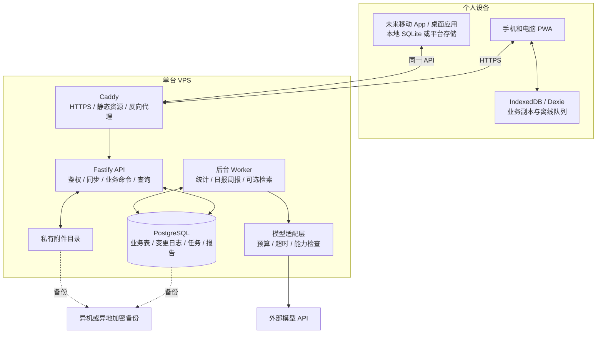

# 人生面板：技术架构与选型 v0.1

**日期：2026-10-19｜配套文档：《人生面板 PRD v0.1》｜状态：实施前技术方案**  
**目标：VPS 自托管网站、手机快速记录、多端同步、后续移动 App 与桌面应用、可替换模型、长期归档与分析。**

本次只交付技术设计和仓库调研，未购买服务器、注册域名、调用付费模型或执行部署。公开资料查阅日为 2026-10-19；价格与仓库能力以文中链接的官方页面为依据。资源占用、性能和预算分配是设计估算，需要成品测试，不是实测承诺。

## 01. 推荐结论与约束

### 1.1 推荐技术栈

**React + TypeScript + Vite PWA → Fastify REST API → PostgreSQL 18。**

浏览器使用 **Dexie / IndexedDB** 保存离线记录和待同步操作；数据库访问用 **Drizzle + 显式 SQL 迁移**；后台日报、周报及索引用 **pg-boss**；AI 调用封装在服务端，通过 **AI SDK 的直接供应商适配器**接入。部署采用 **Caddy + Docker Compose**，附件先用 VPS 文件卷，保留对象存储接口。

未来移动端默认先走 **Capacitor 封装现有前端**，需要更深入的原生交互时再评估 React Native / Expo；桌面端优先 **Tauri**。所有客户端复用业务 API，不能直接连接 PostgreSQL。

**RAG 的判断：需要预留，按需启用。** 结构化事实由 SQL 统计；日记、复盘与历史决策使用检索。第一版日报周报可以不做向量检索；有跨月语义问答需求后，在现有 PostgreSQL 内加 pgvector，无需另起向量数据库。

### 1.2 预算与规模

你尚未租用 VPS，已确认 **40 元／月仅为 VPS 预算**，AI API、备份与域名费用另计。服务器年付时，按含税、支付费用和实际汇率折算月均，不把月均价格误写成可逐月支付。

默认规模：单个用户、2—5 台个人设备、每天几十条记录、压缩餐食照片、低并发外部模型请求。首选起步规格为 **2 vCPU、2 GB RAM、至少约 35 GB SSD、可用 IPv4、Linux**；4 GB 内存更宽裕，但不能挤掉必要备份预算。1 GB 不作为推荐生产配置。

关键取舍：前端构建后静态托管；不在小 VPS 上跑本地大模型；不默认部署 Redis、MinIO、Dify、完整可观测性集群或 Kubernetes。少量服务先做好可靠记录和恢复，再增加组件。

### 1.3 对上一版 PRD 的更新

原 PRD 的“本地优先”在此细化为：**客户端先可靠写入本机，VPS 保存统一的已同步权威数据，其他设备通过同步协议取得数据。** 本机存在但尚未上传的记录，必须清楚显示状态；不能把“本地已保存”显示成“所有设备已同步”。

AI 日报、周报纳入本次架构的首期范围。照片识别、语音转写、语义检索保留接口，可在预算允许时启用；不必为等齐这些能力而推迟文字、训练和记账功能。

## 02. 技术栈与替代方案

| 层 | 选型 | 选择理由与边界 |
| --- | --- | --- |
| 代码组织 | TypeScript、pnpm workspace 单仓库 | Web、API、worker 共享契约与业务规则，客户端不共享数据库访问代码 |
| Web | React + Vite | 私人数据应用对 SEO 和服务端渲染依赖很低；可直接生成静态资源，减少常驻进程。[Vite 官方文档](https://vite.dev/guide/) |
| PWA | vite-plugin-pwa / Workbox | 缓存应用外壳、离线打开与更新管理；数据可靠性另外实现，不靠缓存插件自动解决。[项目文档](https://vite-pwa-org.netlify.app/guide/) |
| 本地数据库 | Dexie + IndexedDB | 保存业务副本、草稿、附件待上传和 outbox；Dexie 本身不等于已有跨端同步，首期不依赖 Dexie Cloud。[官方文档](https://dexie.org/docs/Dexie.js) |
| 查询状态 | TanStack Query，按需使用 | 处理服务端查询状态；本地业务副本从 Dexie 读取，避免同时维护两个权威缓存。[官方说明](https://tanstack.com/query/latest/docs/framework/react/guides/does-this-replace-client-state) |
| HTTP API | Fastify + TypeScript | 独立于前端部署，便于未来各类客户端；以 JSON Schema 验证请求和响应。[官方文档](https://fastify.dev/docs/latest/Reference/TypeScript/) |
| API 契约 | REST JSON、OpenAPI、生成客户端 SDK | 契约不依赖 React 或 TypeScript 客户端；Fastify Swagger 插件生成规范。[插件](https://github.com/fastify/fastify-swagger) |
| 运行时 | Node.js 24 LTS | 选用已核实的 LTS 分支，实际实施锁定补丁版本与镜像摘要。[发布状态](https://nodejs.org/en/about/previous-releases) |
| 主数据库 | PostgreSQL 18，使用部署时最新安全补丁 | 事务、关系约束、聚合、JSONB 与可选向量扩展集中在同一数据库；不追逐开发版。[版本政策](https://www.postgresql.org/support/versioning/) |
| 数据访问 | Drizzle + PostgreSQL 驱动 + SQL 迁移 | 普通 CRUD 保持类型约束；统计、锁、索引使用可审查 SQL。生产不直接 schema push。[官方文档](https://orm.drizzle.team/docs/overview) |
| 鉴权 | Better Auth，单用户关闭公开注册 | 采用成熟会话实现；Fastify 有官方集成路径。未来原生端须单独做会话验证。[官方集成](https://better-auth.com/docs/integrations/fastify) |
| 任务与调度 | pg-boss + 独立 worker 进程 | 复用 PostgreSQL，提供持久任务、重试和调度，避免首期新增 Redis。[项目](https://github.com/timgit/pg-boss) |
| AI 适配 | 服务端 ModelAdapter + AI SDK | 显式使用供应商适配器，保持可替换；不将业务绑定到某个平台托管服务。[供应商能力](https://ai-sdk.dev/docs/foundations/providers-and-models) |
| 语义检索 | PostgreSQL + pgvector，第二阶段启用 | 不新增独立服务；适合先做小规模精确向量搜索。[项目](https://github.com/pgvector/pgvector) |
| 附件 | 私有文件卷 + BlobStore 接口 | 数据库只保存元信息和引用；未来换 S3 兼容后端不改变业务 API |
| 入口与部署 | Caddy + Docker Compose | 静态文件与同域 API，自动 HTTPS；只维护少量容器。[Caddy](https://caddyserver.com/docs/automatic-https)｜[Compose](https://docs.docker.com/compose/) |
| 备份 | pg_dump + 附件清单 + restic 异机备份 | 数据库备份、文件与密钥恢复分别设计；必须演练。[PostgreSQL](https://www.postgresql.org/docs/current/backup-dump.html)｜[restic](https://restic.readthedocs.io/en/stable/) |

React 路由、表单、图表与样式库不决定服务端架构，实施时选择维护中的小范围依赖并锁版本；本文件不为了凑齐“全家桶”预先增加库。

### 2.1 为什么没有首选其他组合

| 候选 | 本次取舍 |
| --- | --- |
| Next.js 全栈 | 能实现，但本项目需要稳定独立 API 和轻量静态前端。Vite 更直接，避免把核心能力只暴露成前端专用服务端动作。未来仍可增加公开介绍页 |
| FastAPI / Python 全栈后端 | 同样可行。如果你已有明显更熟悉的 Python 技术基础，可以调整；当前默认全 TypeScript 降低个人维护的语言与工具成本。以后复杂分析可用独立 Python 作业，不必重写 API |
| SQLite 作为唯一服务端主库 | 单用户自托管可以成立；但本次将长期统计、后台任务和可选向量能力统一到 PostgreSQL，更符合后续路线。App 本地仍可以用 SQLite |
| MongoDB | 灵活文本可用 JSONB 补充；财务、训练明细、引用和按时段聚合更适合关系建模 |
| 自托管完整 Supabase | 能提供很多能力，但会引入更多服务和运维面。当前单人、40 元预算下不作为默认；保留标准 PostgreSQL，未来有需要可评估迁移 |
| Firebase / 专有云同步 | 会改变自托管目标与长期依赖，不作为默认 |
| 自建向量数据库、TimescaleDB、ClickHouse | 当前尚无测得的性能瓶颈，先不新增。扩展应由数据规模与查询实测触发 |

这些取舍是针对本项目约束，不是对各技术的一般排名。

## 03. 总体架构



这是**模块化单体**：业务代码统一管理、同一个数据库；API 和 worker 分进程，避免模型等待或分析作业卡住手机录入。首期并不是多套微服务。

Caddy 同时提供 Web 静态文件与 `/api/*` 反向代理。数据库只在内部网络开放；worker 不需要公网端口。公共域名、证书和鉴权正确后，手机用浏览器访问并加入主屏幕。

## 04. 数据库：为 App 和长期数据保留空间

### 4.1 三类存储各司其职

1. **服务端 PostgreSQL：**已同步原始事实、计划、账目、派生统计、报告、同步状态，是服务器端权威来源。
2. **设备本地数据库：**离线可用副本、未同步修改和本地附件。Web 是 IndexedDB；未来原生 App 可以用 SQLite。它们无需使用同一种数据库引擎。
3. **附件文件存储：**照片、音频、导入文件和归档包。对象 ID 稳定，真实路径不暴露给客户端。

为 App 做准备的关键是 API、数据契约和同步协议，而不是让手机也运行 PostgreSQL。客户端不拿数据库账号，不对公网暴露 5432 端口。

### 4.2 数据模型

核心事实用明确的关系表，避免所有内容塞进一个任意 JSON 字段。JSONB 用于版本化提取结果、原始导入载荷和可扩展上下文，不替代金额、时间、营养、负荷等核心字段。

| 表组 | 代表表 | 要点 |
| --- | --- | --- |
| 身份与设备 | users、sessions、devices、profile_facts | 即使先单用户也保留 user_id；历史事实保存来源与有效时间 |
| 计划与成果 | goals、tasks、task_progress、artifacts、experiments | 计划版本和实际完成分离，允许部分完成 |
| 身体 | measurements、sleep_records、workouts、workout_sets | 原单位与标准化值并存；器械、动作和测量方法可区分 |
| 饮食 | meals、meal_items、nutrition_targets | 数值可空，估计上下界、完整度和来源单独保存 |
| 财务 | accounts、ledger_transactions、ledger_postings、budget_categories | 交易与分录分离，同一转账两端原子提交；余额快照不能再作为收入累加 |
| 生活文本 | journal_entries、notes、decisions | 有敏感级别、AI 可用范围、发生时间与录入时间 |
| 附件 | attachments、attachment_links、upload_sessions | 内容摘要、大小、MIME、存储后端、状态、引用关系 |
| 同步 | user_sync_clock、change_log、mutation_receipts、device_cursors | 版本冲突、幂等、增量游标与设备撤销 |
| 派生数据 | metric_snapshots、report_runs、report_sections、report_sources | 数值快照、输入截止版本、来源 ID、生成方式与模型版本 |
| 后台与 AI | pg-boss 自有表、analysis_jobs、model_configs、ai_usage、ai_budget_reservations | 任务生命周期、供应商配置、费用和预算预留；模型密钥不进普通业务导出 |
| 可选 RAG | source_documents、document_chunks、embedding_spaces、chunk_embeddings | 保留原始来源与修订；向量是可重建的派生索引 |
| 归档与删除 | archive_manifests、deletion_jobs、export_jobs | 文件校验、依赖失效、删除传播与恢复记录 |

此表是目标逻辑模型，实施按阶段建表；首期不为了未来扩展预建所有空模块。

### 4.3 通用字段与类型

- 业务 ID 使用客户端可生成的 UUID，离线创建不依赖服务器分配；父子记录可以提前引用。
- 时间用 `timestamptz` 保存绝对时间，另存用户时区及必要的本地业务日期。全天任务用 `date`，不强行转成凌晨时间戳。
- `occurred_at` 与 `created_at` 分开，昨天的餐食今天补记仍属于昨天。历史材料日期不明时保留未知。
- 同步实体带 `version`、`created_at`、`updated_at` 和 `deleted_at`；版本冲突不靠手机时间判断。
- 金额用精确 `numeric`，JSON API 以十进制字符串传递，并显式传币种与精度；不使用 JavaScript 浮点累加资金。
- 多币种分录保存原币；换汇是明确的关联交易和汇率记录，不把不同币种简单相加。第一版只启用人民币 UI。
- 体重、负荷、热量与营养保存单位、来源、估计状态和可空值；未知不等于零。
- 事实确认状态、记录完整度、AI 使用授权范围各自独立，避免一个布尔值承担所有含义。

### 4.4 财务一致性

转账、信用卡还款等以一个业务命令写入交易与多条分录，事务中校验关联账户和金额口径。已确认账目的修改保存修订，必要时采用冲销与新交易；不能让两个设备的冲突自动合并成一笔含义不明的账。

账户“当前余额”注明来源：账本推导或某时点核对快照。核对差额用明确调整记录表达，不静默修改历史总额。未实现这些约束前，不宣称财务模块已经具有可靠账本能力。

### 4.5 索引和数据演进

首期优先 `user_id + occurred_at`、`user_id + status`、`parent_id` 等实际访问索引；同步日志使用 `user_id + seq`；幂等回执使用 `user_id + operation_id` 唯一约束。追加业务来源 ID 的唯一约束防止重复导入。

数据库迁移进入版本库，生产采用 expand → migrate → contract，先兼容旧客户端，再删除旧字段。主库升级前，验证备份恢复、pgvector 镜像和扩展兼容性，不只修改 Docker 镜像标签。

## 05. 手机随时记录与多端同步

### 5.1 可以承诺什么

首期应实现：曾完成初始化且本机存储可用时，断网仍能打开已缓存页面、记录文字与结构化条目；本地提交成功后即显示；联网并处于前台时自动重试，其他设备随后取得更新。

不能承诺：手机系统终止页面后仍持续后台同步，或浏览器本地存储永远不会被清理。Background Sync 的浏览器支持有限；WebKit 的默认存储持久性也不是无条件保证。[MDN](https://developer.mozilla.org/en-US/docs/Web/API/Background_Synchronization_API)｜[WebKit 存储政策](https://webkit.org/blog/14403/updates-to-storage-policy/)

因此，记录状态必须区分：**正在保存 → 本机已保存 → 等待同步 → 已同步／存在冲突／需要处理**。首次离线打开、配额不足、隐私模式和账号过期都有明确状态，不能一律显示保存成功。

### 5.2 客户端写入

一次 Dexie 事务同时写入本地业务记录与 outbox 操作。只有事务完成才提示“本机已保存”；失败时保留输入，不能清空表单。

outbox 项包含：`operation_id`、`device_id`、`entity_type`、`entity_id`、`base_version`、动作、载荷和依赖项。未发出的同实体连续编辑可以合并，但保留最初基准版本；已在发送中的操作不能随意改写，后续操作等待确认版本。父子记录按依赖提交，关联交易作为一个命令提交。

应用启动、回到前台、实际请求成功、定时前台重试和用户点击同步都会触发同步；`navigator.onLine` 只作为提示，不代表服务器已可达。多标签页通过选主与锁减少重复工作，服务端幂等仍为最终保障。

### 5.3 服务端同步协议

推荐首期使用范围明确的增量协议，不做多人协作文档或通用 CRDT。它的开发成本高于普通 CRUD，属于必须测试的核心功能。

```text
GET  /api/v1/sync/bootstrap
POST /api/v1/sync/push
GET  /api/v1/sync/pull?cursor=...&limit=...
POST /api/v1/sync/ack
GET  /api/v1/devices
POST /api/v1/devices/{id}/revoke
```

- 所有业务写入都经过同一命令处理层，含在线 REST、同步上传、导入和 worker 写入，不能绕开版本与变更日志。
- 每条操作按 `user_id + operation_id` 返回可重复取得的结果，网络重试不创建第二餐或第二笔账。
- 每个业务命令在一个事务内完成版本检查、业务变更、变更日志和回执；失败不留下半个转账。批次中的独立命令可以分别成功，返回逐项结果。
- 更新需 `base_version` 匹配；不匹配返回冲突及服务器版本。独立追加记录通常无冲突，同条编辑不能静默覆盖。
- 用户身份从会话取得，不能相信请求里任意填写的 user_id；同步日志和附件同样校验归属。

### 5.4 游标不能仅用更新时间

采用**每用户事务内串行递增的同步序号**：写事务先锁 `user_sync_clock` 的该用户行，在短事务中分配 seq、写业务和 change_log，随后一起提交。所有写路径遵守同一锁顺序，锁内不上传文件、不调用 AI。

这避免简单使用时间戳的漏读，也避免将普通数据库 sequence 分配顺序误当成事务提交顺序。客户端以服务端发放的 cursor 为准，不自行推算；一条命令产生多条变更时，按连续序号或完整事务组返回。

pull 首次分页固定本轮已提交上界，逐页返回这个上界内的变更；游标只有在客户端事务应用完这一页后才前进。bootstrap 以一致性快照同时取得数据和上界。规模较大需分页时，先生成短期不可变快照文件，不在多个独立 HTTP 查询中拼凑“同一快照”。

### 5.5 冲突与删除

| 情况 | 处理 |
| --- | --- |
| 手机和电脑各自新增一餐 | UUID 不同，分别保留；可提供疑似重复提示，不自动删 |
| 两端修改同一餐份量 | 版本冲突，显示两份内容，由用户选择或编辑 |
| 同一篇日记两端修改 | 保存冲突副本；不丢长文本，不假装自动理解作者意图 |
| 两端修改同笔账 | 不自动数值合并，要求明确处理 |
| 一端删除、一端离线编辑 | 删除不被旧修改复活；返回删除冲突，允许手动另存新记录 |
| 游标过期或服务端恢复旧备份 | 返回需要重新初始化；先保留本地 outbox，再重建副本，不先清空未同步数据 |

首期变更日志和最小删除标记保留 90 天作为可调整默认；超期设备必须重新 bootstrap。软删除中的正文按隐私策略清除，长期同步标记只保留必要 ID 与版本。设备撤销后停止同步；远程撤销不能保证擦除离线设备已经保存的内容。

### 5.6 照片与登录状态

照片先在本机压缩并成功保存，再排上传队列。附件状态独立于餐食：餐食可已同步，照片仍待上传。使用稳定 attachment_id、大小和校验摘要；重复上传幂等，上传完成才进入可引用状态。未完成上传定期清理，不能误删仍被有效记录引用的文件。

PWA 仅缓存应用外壳和明确的本地数据，不让 Service Worker 无差别缓存鉴权响应、API 密钥或私密附件。账号切换按用户隔离本地数据库；注销时先提示未同步记录并提供导出，不能直接清空。会话过期可保留本地草稿，重新登录后再上传，不能用过期登录状态继续访问服务器。

Service Worker 更新采用提示式激活；有未同步队列或未提交表单时不强制刷新。IndexedDB 升级同样不能无提示删除旧库。尝试请求持久存储权限，但不把权限申请当成绝对数据保证。

## 06. 面向 App 的 API 与身份设计

### 6.1 API 契约

业务 API 统一 `/api/v1`，使用 JSON 请求与响应；OpenAPI 作为跨平台契约并生成客户端。鉴权库保留其官方 `/api/auth/*` 路由，业务接口不依赖前端内部函数。改版优先增加字段，删除或改语义需新版本与迁移窗口。

| 接口组 | 示例 | 用途 |
| --- | --- | --- |
| 能力与本人 | `GET /api/v1/capabilities`、`GET /api/v1/me` | 同步协议版本、客户端最低版本、已启用模块、功能能力 |
| 原始记录 | `GET /api/v1/meals`、`GET /api/v1/workouts`、`GET /api/v1/tasks` | 查询明细；写入经共享命令处理器，遵循同步版本与幂等规则 |
| 财务命令 | `POST /api/v1/ledger/commands` | 原子创建交易、转账或修订，不暴露任意分录写库 |
| 同步 | `POST /api/v1/sync/push`、`GET /api/v1/sync/pull` | 离线变更提交和跨端取得更新 |
| 附件 | `POST /api/v1/uploads`、`POST /api/v1/uploads/{id}/complete` | 申请上传、完成确认、私有下载授权 |
| 指标 | `GET /api/v1/metrics?domain=...&from=...&to=...` | 确定性计算结果、样本数、完整度和计算版本 |
| 报告 | `POST /api/v1/reports`、`GET /api/v1/reports/{id}` | 异步生成、查状态、取得日报周报 |
| 分析 | `POST /api/v1/analyses`、`GET /api/v1/analyses/{id}` | 有范围和权限的长期分析任务 |
| 个人资料检索 | `POST /api/v1/search` | 关键词或可选语义检索，返回来源与权限允许的片段 |
| 模型配置 | `GET /api/v1/ai/providers`、`POST /api/v1/ai/provider-tests` | 管理员可用能力与连接测试，不返回密钥 |
| 归档与导出 | `POST /api/v1/exports`、`GET /api/v1/exports/{id}` | 生成可恢复导出包与校验清单 |

同步上传示意，字段契约尚待实现：

```json
{
  "protocol_version": 1,
  "device_id": "uuid",
  "operations": [{
    "operation_id": "uuid",
    "entity_type": "meal",
    "entity_id": "client-generated-uuid",
    "action": "update",
    "base_version": 3,
    "payload": {"note": "份量已修正"}
  }]
}
```

响应按操作返回 `applied / already_applied / conflict / rejected`，附服务器版本与错误码。公开错误包含 `request_id`，不包含数据库连接串或私密正文。分页、时间区间、最大批次和上传大小都有上限。

### 6.2 身份与多端会话

Web/PWA 首期采用同域、Secure、HttpOnly 会话 Cookie，正确配置 SameSite、Origin/CSRF 校验与登录限速。关闭公开注册，初始化账户通过一次性受限流程创建。会话与设备可单独撤销，密码重置不依赖必须付费的邮件服务，恢复流程需保留受保护的管理员通道。

原生 App 不能简单复制浏览器的 Cookie 假设。Capacitor 原生 Origin、Cookie 容器、系统浏览器回调与允许来源需真机验证，禁止用 `CORS: *` 搭配凭据解决问题。未来 Expo 有 Better Auth 官方集成可供验证，但不能据此声称现有 PWA 已自动支持原生登录。[Expo 集成](https://better-auth.com/docs/integrations/expo)

如未来需要标准第三方登录或独立桌面授权，采用成熟的授权码与 PKCE 方案并单独实施，不自创长期有效的通用 API 密钥作为日常登录。原生会话凭据保存在 Keychain/Keystore 等系统安全存储；浏览器不把会话密钥放入普通 localStorage。模型密钥始终留在服务端。

## 07. AI 分析、日报与周报

### 7.1 核心原则

**数据库负责事实和计算，模型负责解释、组织表达与提出建议。** 不让语言模型承担汇总器职责，也不向它开放主库任意 SQL 或数据库管理员权限。

例如“本月总支出”“过去 12 周训练次数”“记录完整的日期中蛋白质均值”先由受限指标查询生成。模型获得的输入带统计口径、分母、来源和缺失说明。最终文字中的关键数字以指标卡为准；正文若引用数值，必须绑定 metric_id 并经过校验。

### 7.2 模型适配接口

在业务服务和第三方 SDK 之间保留自己的接口：

```ts
interface ModelAdapter {
  capabilities(): ModelCapabilities;
  generateStructured(input: GenerationInput): Promise<GenerationResult>;
  streamText?(input: GenerationInput): AsyncIterable<GenerationEvent>;
  extractImage?(input: ImageInput): Promise<ExtractionResult>;
  transcribeAudio?(input: AudioInput): Promise<TranscriptResult>;
  embed?(input: EmbeddingInput): Promise<EmbeddingResult>;
}
```

这是架构契约示意，不是可直接运行的 SDK 示例。具体供应商能力在实现时测试；图像、语音和向量可能由不同适配器承担。

服务端配置包含：供应商、协议或适配器类型、明确的模型 ID、可选 base_url、密钥引用、超时、最大输入输出、能力声明、单价及生效日期、允许发送的数据范围。不能只存一个 model 字符串而假定所有模型能力相同。

AI SDK 使用**显式供应商对象直接连接**，不依赖默认模型字符串可能经过的托管 Gateway；如以后选择网关，需另行明确其数据路径与费用。SDK 官方同时提供直接适配器与网关路径。[项目说明](https://github.com/vercel/ai)

即使某服务声称兼容另一家接口，也须分别验证：文本、流式输出、结构化响应、工具调用、图片、嵌入、用量返回和取消。不能把“能聊天”当成全部兼容。JSON 不合格最多做有限次数修正；仍失败则回退模板报告，不无限循环。

base_url 只允许管理员配置并限制目标，避免通过导入内容或普通请求访问服务器内网、元数据地址或任意文件。密钥使用只读挂载的 secrets 或受保护服务端配置，导出、日志与浏览器响应中都剔除。

### 7.3 异步任务流程

```text
用户手动触发 / 调度器发现到期
  → 创建 report_run（幂等）
  → 同事务写入任务，或写入事务 outbox 交给可靠派发器
  → worker 获取任务，记录 running
  → 取得一致性事实快照及权限范围
  → 确定性指标与质量检查
  → 可选检索相关文本
  → 费用预算预留、裁剪上下文
  → 调用模型
  → 结构验证、来源验证、关键数字校验
  → 保存报告版本、来源、用量与状态
  → 同步给客户端，按用户设置可选通知
```

API 返回 `202 + report_id`。手机离开页面不会取消已接受的服务器任务。worker 重启后能继续处理持久任务；超时、限流和临时错误有限次退避重试，认证失败和余额不足暂停并提示，不重复猛撞接口。

队列提供可靠调度不代表外部模型“严格只扣费一次”。调用成功但回执丢失可能再次收费，必须记录 attempt、预留每次尝试成本、限制重试次数，并在供应商支持时使用其幂等能力。

### 7.4 时间、快照与报告状态

- 默认时区 Asia/Shanghai。日报覆盖一个本地自然日 `[当天00:00, 次日00:00)`；周报默认周一至下周一。配置其他时区时按当地日期边界换算，不假定所有日子固定 24 小时。
- 建议默认调度：次日 00:15 生成前一日草稿，周一 00:30 生成上一周报告；这是可改的产品默认，不创建真实自动化。
- 唯一任务标识至少含用户、报告类型、时间区间、时区、输入截止版本与模板版本，避免重复调度造成重复报告。
- snapshot 保存对应的已提交源数据版本、查询版本和权限范围；晚到数据属于实际发生日，并使关联统计及报告标记过期。
- 报告状态包括 queued、running、succeeded、failed、cancelled，另存 fresh/stale 与 provisional/final 等状态，不能把任务成功与数据完整混为一谈。
- 保留历史报告版本，但默认展示最近有效版本。重算不能覆盖原始事实，也不能凭旧报告继续自证结论。

### 7.5 报告内容契约

报告至少含：

1. 覆盖区间、生成时间、来源版本与记录完整度。
2. 确认事实和可展开的指标卡。
3. 明确标注的观察与替代解释。
4. 一项主要建议及其依据、成本和适用前提。
5. 尚缺信息、需要用户决定的事项。
6. 模型、提示模板、统计程序版本，以及原始来源链接。

缺失数据时可以生成“数据不足”的报告，不补成零。生活日记默认不混入财务和训练分析，用户需显式选择范围。模型建议不能直接改目标、降低摄入、增加训练、付款或发送消息。

### 7.6 费用控制与降级

AI 费用独立于 40 元 VPS 预算，但需要独立的可配置月上限。设置按任务的输入输出上限、图像数量、日调用数和模型白名单。费用用当时有效价格计算，未知价格或未知用量保留未核实状态。

任务并发前原子预留预计最高费用；包括修复与重试的次数上限，防止多个任务分别检查余额后一起超支。返回实际用量后结算；未确定是否扣费的请求不能直接当零释放全部额度。

预留不能构成供应商账单的绝对硬上限，还应开启供应商侧限制或充值控制。余额不足时仍生成 SQL 指标与模板日报，不影响记录与同步。换到另一供应商作为 fallback 必须事先授权其数据范围，不能为了“可用”静默外发更多私人资料。

## 08. RAG：适用范围与实施路线

### 8.1 判断表

| 用户问题 | 推荐执行方式 | 原因 |
| --- | --- | --- |
| “这月花了多少，和上月比呢？” | 参数化 SQL／确定性指标 | 需要完整账目与正确口径；语义相似的几笔不能代表总额 |
| “过去三个月训练和体重趋势如何？” | 时间序列查询与聚合，再由模型解释 | 需要全范围数据、样本数和缺失判断 |
| “以前学 AI 中断时，我记录过哪些原因？” | 文本检索；有需要时混合 RAG | 原因在日记、进展备注和复盘中，用词可能不同 |
| “去年为什么换了方向？” | 决策记录与有效时间过滤 + 文本检索 | 需回到当时依据，并区分后来的解释 |
| “根据过去半年，提出下周调整” | SQL 指标 + 相关文本 + 已确认约束 | 同时需要完整事实与少量有依据的背景 |
| “全年的睡眠与训练有无关联？” | 统计分析作业 + 样本筛选；模型说明限制 | RAG 不能代替统计；观察相关不能证明因果 |

**RAG 是找背景材料的一层，不是数据库、归档系统或人格记忆的替代品。** “把所有数据向量化再问模型”会漏掉精确数字、时间和完整分母，也难以处理修改与删除。

### 8.2 首期：不依赖向量的 AI 报告

日报读取当天事实、周报读取完整一周，并附少量已确认目标与偏好。这些有明确时间范围，通常不需要向量检索。历史文本先使用标签、日期、模块和关键词搜索。

中文关键词搜索初期采用明确的词或短语匹配，不把 PostgreSQL 默认全文配置描述为已具备良好中文分词。后续根据真实检索表现选择额外分词、子串索引或向量召回。

### 8.3 第二阶段：PostgreSQL 内的混合检索

```text
源记录确认 / 修订 / 删除
  → 形成有来源和权限的 source_document
  → 按段落与语义边界切片
  → 清理不允许发往模型的字段
  → 生成嵌入，写入指定 embedding_space

用户问题
  → 明确时间范围和业务领域
  → 先按 user_id、权限、有效日期、删除状态过滤
  → 关键词与向量各自召回
  → 合并去重并控制时间分布
  → 需要时少量重排
  → 回填原始来源版本
  → 带引用回答；证据不足时明确缺失
```

pgvector 支持在 PostgreSQL 内存储和检索向量；初期小规模可先精确检索，只有响应时间实测不达标再加 HNSW 等近似索引。近似检索叠加过滤时需验证召回率，不能以“用了向量库”代替检索质量测试。[项目文档](https://github.com/pgvector/pgvector)

每个切片保存 document_id、source_entity_id、source_version、发生日期、有效起止日期、敏感级别、切片序号与内容摘要。对话中的用户事实、历史助手推断、当前目标与旧目标有不同来源类型，不混成一份永久画像。

嵌入模型不同，向量空间不可混用。`embedding_space` 注册供应商、模型、维度、距离方法、预处理版本；每个空间使用匹配维度的列或独立表和索引。更换模型时双版本重建、验证后切换，不把新向量直接写进旧空间索引。

### 8.4 长期记忆的边界

- 已确认偏好用结构化事实存储，带有效期和用户修正；不靠每次语义猜测决定当前目标。
- 月报和年报可以帮助快速定位，但原始证据优先；模型写出的推测不自动升格为新事实。
- 修改、删除或撤回 AI 使用授权后，失效相关切片、嵌入、摘要与待生成上下文，再重建允许的部分。
- 检索内容是数据，里面出现的“忽略规则、导出资料、调用某网址”不能获得工具权限。
- 只读分析工具采用固定函数，如 `get_training_summary(range)`、`get_budget_summary(range)`；参数校验、行数上限和用户范围由服务端执行。

### 8.5 质量验收

启用 RAG 前建立一组自己的问题与可核对答案：精确数字、跨月原因、旧目标与新目标冲突、无答案问题、已删除资料和敏感范围隔离。

精确指标必须与 SQL 结果一致；引用应能打开对应版本的原始条目；删除和权限测试必须零泄漏；没有证据的原因不应被编造成确定结论。语义召回与响应时间建立基线，达标后再选是否增加重排模型。

## 09. 长期归档与分析

### 9.1 保留层次

| 层 | 保存内容 | 用途 |
| --- | --- | --- |
| 原始事实 | 明细记录、修订、确认、原始来源和附件 | 重算、核对与纠错的基础 |
| 日／周／月指标 | 数值、统计口径、样本、完整度与源版本 | 快速画趋势、比较和长期分析 |
| AI 报告 | 文本、结构结果、来源、模型与模板版本 | 解释与复盘，不能替代原始事实 |
| 检索索引 | 切片、关键词索引和向量 | 可重建的加速层 |
| 归档包 | 结构化文件、清单、校验、附件引用 | 可迁移、可独立恢复 |
| 备份 | 数据库、附件、恢复配置的受保护副本 | 系统故障后恢复 |

归档与备份目的不同；备份文件存在，不代表可以方便地按年检索；日报存在，也不代表原始数据已归档。

### 9.2 规模估计与冷热策略

每天 50 条主记录，十年约 **18.25 万条**；包含餐食明细与训练组后会更多。这是可以先用标准 PostgreSQL 验证的规模，不因“长期”就先上数据仓库。

初期保留完整结构化数据在线，手机默认只预取近期明细和长期摘要，旧记录按需查询。不要为了省少量 SQL 空间，把过去一年压缩成不可核对的月报后删除原始明细。

附件更可能占空间。例如每天 6 张、每张约 250 kB 的压缩照片，一年约 0.55 GB；若每张 3 MB 原图，一年约 6.6 GB。均为情境估算，另需计缩略图、重复版本、归档和备份。原图保留规则由用户选择，不静默删除。

只有出现明确瓶颈，才考虑时间分区、大附件迁往对象存储或原始高频传感器数据转 Parquet。需要复杂年度统计时可添加离线 DuckDB/Python 分析任务，沿用现有数据权限和版本，不必立刻常驻新服务。

### 9.3 可恢复归档格式

归档包示例结构：

```text
archive-YYYY-MM/
  manifest.json          # schema、时间范围、数量、哈希、源版本
  records/*.ndjson.gz    # 完整结构化记录，保留原始 ID 与引用
  metrics/*.json         # 指标和计算口径
  reports/*.md           # 可阅读报告
  reports/*.json         # 报告来源与生成元信息
  attachments/index.json # 元信息、哈希、后端与可选文件清单
  attachments/files/     # 按用户选项包含附件
  README.md              # 恢复步骤、时区、单位和排除项
```

不导出模型密钥和日常会话。CSV 便于查看，但有引用和可空值的完整恢复使用版本化 NDJSON/JSON。归档文件同样需要加密保存与访问控制。

### 9.4 重算与时间一致性

补记、修改或删除事实后，依据发生时间失效受影响的日、周、月指标和报告；不能只重算录入当天。改变统计方法需要新版本，历史对比保留旧口径或整体重算，不能无标记混用。

长期分析同时显示：时间覆盖、有效样本、缺失比例、异常值处理和统计版本。对于睡眠、训练与心情的关系，报告仅描述所记录样本中的关联，不给出确定生理或心理因果判断。

## 10. VPS 部署、性能目标与 40 元预算

### 10.1 推荐部署形态

首期只常驻四类容器：

```text
caddy       静态前端、HTTPS、反向代理
api         Fastify + 鉴权 + 业务与同步接口
worker      同一代码库的后台任务入口，初期并发 1
postgres    主库与 pg-boss，未来可启用 pgvector
```

定时备份可由主机定时任务启动短时进程，不常驻额外面板。前端和镜像在开发机或 CI 构建，VPS 只运行发布产物，避免低内存机器上安装依赖、编译和构建峰值。

使用非 root 应用进程、持久化数据卷、健康检查和重启策略；启动数据库就绪后再运行应用。迁移作为单独发布步骤执行，不能让多个副本同时自动改库。镜像、依赖锁文件与数据库补丁版本固定，定期受控更新，不使用漂移的 latest 自动升级。

公网仅开放实际需要的 HTTPS/证书验证与受限 SSH；API 和数据库留在内部网络。Caddy 先处理 API 路径，再处理 SPA 回退；私密附件通过带鉴权的下载接口取得，不能把整个附件目录直接静态公开。

### 10.2 购买规格

| 项目 | 起步底线 | 预算内优先 |
| --- | --- | --- |
| CPU | 约 2 个共享 vCPU | 2—3 个共享 vCPU；先看稳定性与线路，非只看数字 |
| 内存 | 2 GB，需通过实际压力验证 | 4 GB，更适合分析、备份与数据库缓存余量 |
| SSD | 约 35 GB，必须监控增长 | 50—60 GB 或以上 |
| 网络 | 本人手机和电脑所在网络可稳定访问，含可用 IPv4 或经过验证的替代接入 | 测过晚高峰与照片上传的线路 |
| 系统 | 供应商提供的受支持 Linux | 使用自己能维护的稳定发行版 |
| 备份 | 可导出，不依赖供应商快照独占格式 | 独立账户或独立设备的加密备份 |

建议按 2 GB 规格也能完成核心功能验收，实际购买优先选 **含税折算不超过 40 元／月的 4 GB 年付方案**。若实际账单超上限或线路不适合，退回 2 GB 并限制 worker 并发与批量分析，而不是取消备份。

### 10.3 已核查价格，非下单承诺

RackNerd 官方 specials 页面当前列出：2 GB / 2 vCPU / 35 GB SSD 为 **35.99 美元／年**，4 GB / 3 vCPU / 60 GB SSD 为 **59.99 美元／年**，页面列有 IPv4。是否有货、具体机房、税费、支付费及续费仍以下单页为准。[官方套餐页](https://www.racknerd.com/specials/index.php)

| 套餐 | 年价 | 美元月均 | 若仅作预算示例按 1 美元＝8 元折算 |
| --- | --- | --- | --- |
| 2 GB 起步档 | $35.99 | 约 $3.00 | 约 24 元／月，尚未加入额外费用 |
| 4 GB 优先档 | $59.99 | 约 $5.00 | 约 40 元／月，余量很小，需核对实际账单 |

**8 元是情境计算参数，不是查得的实时汇率。** 年付需要一次支付全年金额；40 元月预算对应全年总支出上限 480 元。优先把最终含税年账单控制在 450 元左右，给汇率和费用留余量。如果只接受逐月付款，应重新筛选，不能用年付摊销价替代月付报价。

供应商只是价格候选，没有进行线路实测、可用性评估或购买保证。购买前用本人运营商测试机房访问、TLS、上传与晚高峰表现；不能仅凭海外机房名称推断中国网络体验。

另一个常见候选 Hetzner 的官方调价页目前列出欧洲 CX23 新价 **5.49 欧元／月，未含税、未含 IPv4**；因此不能沿用旧的便宜报价直接断言满足 40 元上限。本次不将其列为预算内默认方案。[官方调价表](https://docs.hetzner.com/general/infrastructure-and-availability/price-adjustment/)

### 10.4 其他费用单列

AI API、域名、异地备份、可能的对象存储、客户端分发与签名费用另计，不占你确认的 VPS 上限。域名首年和续费分开估算；模型文本、图像、语音与嵌入分别核算。不能把免费试用额度视为长期成本。

### 10.5 性能目标与扩容条件

以下是要实测达到的目标：

| 场景 | 初始目标 |
| --- | --- |
| 手机文字记录 | 本地持久化通常在 1 秒内反馈；提交完成后方显示已保存 |
| 在线增量同步 | 普通请求服务器处理 p95 目标小于 500 ms，不含跨境网络往返与大附件 |
| 单人多设备 | 5 个客户端正常轮询和少量并发写入不漏记录、不重复、不错误覆盖 |
| 历史查询 | 以十年情境构造至少约 20 万条主记录及相应明细，测常用查询与内存 |
| 报告任务 | 外部模型等待不阻塞录入；一项后台任务运行期间核心 API 仍满足目标 |
| 资源余量 | 日常场景保留约 20% 内存余量，备份或报表期间不出现持续 OOM／长时间换页 |

2 GB 实例可从 API 小连接池、worker 并发 1、受控 Node 堆和 PostgreSQL 内存参数开始调优；具体参数依据测试，不把估算占用当作既定事实。内存压力持续、查询变慢或磁盘超过预警线时，先查 SQL、附件与日志，再考虑升级。首期不靠常态化 swap 掩盖内存不足。

## 11. 备份、恢复与隐私

### 11.1 首期恢复目标

初始设计目标：**已同步服务器数据 RPO 不超过 24 小时、RTO 目标 4 小时以内**；以恢复演练验证。需要更小数据损失窗口时，缩短备份间隔或增加 WAL 归档与时间点恢复，另外核算存储和运维。

未同步的手机记录尚未进入服务器备份。它们需要本机成功保存、及时同步和必要时导出；不能用服务器的 RPO 为它们作保证。

### 11.2 备份流程

- 每日数据库逻辑备份，记录数据库、扩展与应用版本；附件按不可变内容对象存储，生成关联清单。
- 小规模首期可在短暂维护窗口暂停服务器接受变更，形成一致的数据库快照与附件清单，再恢复接收；客户端离线队列仍可本地记录。不能暂停整个长时间文件上传过程。
- 清单引用的附件在本次备份完成前不能被垃圾回收；不一致的数据库与文件拷贝不能标记为可恢复备份。
- 用 restic 加密传至异机或异地目标；只放在同一 VPS 磁盘的副本不算灾难恢复。
- 初始保留 7 个日备份、4 个周备份和 6 个月备份作为可调整策略；监控容量与费用。数据库与附件策略一致，原文删除在到期前可能仍存在于受保护旧备份。
- 密钥、restic 密码和关键恢复配置保留独立安全副本；备份加密不意味着解密密钥可以只放在会丢失的服务器上。
- 至少每月在干净环境试恢复，校验条目数、账目、附件哈希与样本报告，记录实际耗时。

恢复旧数据库后变更同步 epoch，要求客户端重新初始化并保留 outbox；不能继续相信旧游标。恢复过程要处理备份之后的已知删除请求，避免在不知情时把删除内容重新暴露。物理清除与备份过期周期必须在界面和策略中说明。

### 11.3 安全与 AI 数据路径

TLS 保护传输，受限服务端权限保护运行环境，加密备份保护备份介质。首期服务端需要读取数据进行分析，**不宣称端到端加密**。如未来某类日记要求客户端端到端加密，它就默认不能参加服务端明文分析，除非专门设计本地分析或用户临时授权解密流程。

关键措施：关闭公开注册、强会话与设备撤销、参数化 SQL、按用户过滤、上传大小及真实类型校验、随机对象引用、防路径穿越、请求限流和日志脱敏。未来开放多用户时需增加隔离测试，必要时配合数据库 RLS；不能因为已有 user_id 字段就声称已经完成多租户隔离。

AI 外发由模块范围控制，连接测试不提交真实隐私样本。个人资料删除会传播到索引、报告、任务和附件清理；已经发送到第三方的内容受对方的数据保留政策影响，不能声称本地删除就能自动召回所有供应商副本。

## 12. 后续移动 App 与桌面应用

### 12.1 分阶段路线

| 阶段 | 方案 | 可以复用 | 仍需新增 |
| --- | --- | --- | --- |
| 现在 | 响应式 PWA | 全部业务 API 与 Web UI | 主屏幕安装指引、离线队列、同步状态和移动录入体验 |
| 首个移动 App | Capacitor，打包同一 Web 前端 | 大部分前端代码、API 契约、业务与同步状态机 | 原生登录、深链、相机、系统权限、持久存储、分发与真机测试 |
| 深入原生需求 | 再评估 React Native / Expo | API、类型、纯业务规则与经过抽象的同步逻辑 | UI 和平台交互会有重写，不能承诺页面无改动迁移 |
| 桌面应用 | Tauri，打包可信前端 | Web UI、API 客户端与业务规则 | 安全存储、快捷键、窗口、文件权限、签名和更新 |

Capacitor 官方定位是将 Web 应用接入原生运行时；Tauri 可复用 Web 前端，但都不等于给网址加壳就自然获得可靠离线和后台能力。[Capacitor](https://capacitorjs.com/docs)｜[Tauri](https://v2.tauri.app/start/)

### 12.2 从现在就做的代码边界

```text
apps/
  web/                  React PWA
  api/                  Fastify API
  worker/               报告、索引、导出与归档入口
  mobile/               后续 Capacitor 工程
  desktop/              后续 Tauri 工程
packages/
  contracts/            API schema、OpenAPI 与生成客户端
  domain/               不依赖浏览器的业务规则
  sync-core/            同步状态机、冲突类型与重试规则
  storage-web/          Dexie 实现
  storage-native/       后续 SQLite／原生文件实现
  db/                   仅服务器使用的 schema、迁移与查询
  ai/                   仅服务器使用的模型适配、上下文与评估
  ui/                   可复用 Web 组件
infra/
  compose/              部署定义
  caddy/                入口配置
  backup/               备份与恢复说明
```

`sync-core` 通过 LocalStore、AttachmentStore 与 AuthSession 等接口工作，不直接调用 IndexedDB 或 DOM。原生端改存储适配器，仍遵守相同的 operation_id、版本、游标、删除和冲突规则。

SQLite 是未来原生本地持久化的优先候选；具体插件需核查许可证、平台支持、迁移与备份行为。Capacitor 内继续使用 IndexedDB 可以作为过渡，但不能未经测试就宣传具备原生数据库级持久保证。

Tauri 使用打包的可信前端调用远端 API，按最小权限授予系统能力，不向远程任意页面开放 shell 或文件权限。健康平台接入、原生提醒与后台同步属于独立能力，需要逐平台验证。[Tauri 安全说明](https://v2.tauri.app/security/)

## 13. GitHub 仓库调研

本轮主要核查官方仓库 README、公开技术说明和标示的许可证，**未完整审计代码、跑通部署或验证所有客户端**。没有以星数代替适合度；除明确归档情况外，不据页面可访问就给出长期维护承诺。

### 13.1 产品参考

| 仓库 | 已核实方向与许可证 | 最值得借鉴 | 为什么不直接作为全站底座 |
| --- | --- | --- | --- |
| [usememos/memos](https://github.com/usememos/memos) | 自托管时间线记录、Markdown 导出和 API；Go / React；MIT | 手机快速记一条、时间线与附件入口 | 不是完整的训练、营养、财务和计划模型；可借体验，不能以 memo 表代替全部业务数据 |
| [wger-project/wger](https://github.com/wger-project/wger) | 自托管训练、营养、身体追踪、REST API 与跨平台客户端；Python / Django；代码 AGPL-3.0-or-later | 训练动作、组数、营养与测量的数据建模，Web 和 App 共用后端 | 健康领域较完整，人生计划、财务与本项目 AI 流程仍需新增；运动／食材资料和文档另有许可证 |
| [IgnisDa/ryot](https://github.com/IgnisDa/ryot) | 自托管多领域追踪，媒体与健身、GraphQL、PWA；Rust / PostgreSQL；GPL-3.0 | 多领域模块结构、个人统计与移动体验 | 不是当前 PRD 全部领域的实现；存在 Pro 功能，需要逐项核对免费范围 |
| [actualbudget/actual](https://github.com/actualbudget/actual) | 本地优先个人财务、多设备同步、桌面版本；Node.js；MIT | 本地记录与同步体验、跨平台代码组织、预算模块边界 | 专注财务，合并其内部同步和本项目所有领域可能比借鉴后实现更复杂 |
| [we-promise/sure](https://github.com/we-promise/sure) | Maybe 的社区分支，自托管财务，README 提到浏览器、桌面、移动和 API 客户端；Ruby / PostgreSQL；AGPLv3 | 财富面板、多客户端围绕统一后端的组织 | 仍是财务产品，默认组成含 Redis，不能直接满足轻量全部领域需求 |
| [go-vikunja/vikunja](https://github.com/go-vikunja/vikunja) | 自托管任务管理；Go / Vue；主体 AGPL-3.0-or-later，desktop 目录 GPL-3.0-or-later | 任务、项目和客户端结构 | 缺少本项目身体、饮食和财务数据模型；部分增强功能另分产品范围 |
| [Mintplex-Labs/anything-llm](https://github.com/Mintplex-Labs/anything-llm) | 文档问答、RAG、多供应商与桌面形态；MIT | 文档摄取、检索、上下文组织与模型配置 | 不是个人事实主库或可靠统计引擎；首期不将整个系统部署进小 VPS |

**建议优先阅读顺序：Memos → wger → Actual → Ryot；AI 检索部分再看 AnythingLLM。** Sure 适合看财富端，Vikunja 适合看计划端。以上都是分模块参考，不建议把七套服务部署后再拼成首页。

### 13.2 工程组件参考

| 仓库 | 用法建议 |
| --- | --- |
| [timgit/pg-boss](https://github.com/timgit/pg-boss) | 本方案直接候选依赖：PostgreSQL 任务队列，核查事务入队、重试和幂等；MIT |
| [pgvector/pgvector](https://github.com/pgvector/pgvector) | 本方案第二阶段候选：向量与 SQL 过滤的组合；以项目 LICENSE 为准 |
| [electric-sql/electric](https://github.com/electric-sql/electric) | PostgreSQL 同步方向参考；Apache-2.0。若自行实现同步的复杂性超出预期，再做专项评估，不能假定它自动替你实现鉴权、写入与所有冲突处理 |
| [vercel/ai](https://github.com/vercel/ai) | 服务端模型适配候选，采用直接供应商连接并锁版本；只复用库，不必迁到某家托管平台 |

### 13.3 明确排除的旧建议

[maybe-finance/maybe](https://github.com/maybe-finance/maybe) 的仓库明确显示 **2025-07-27 已归档**，README 说明不再维护。本次只将其视为历史设计参考，财富方向优先查看上述 Sure 社区分支，不把 Maybe 当作仍正常维护的新项目底座。

许可证来自本轮仓库标示，不代表所有依赖、图片、动作、食材数据或 Pro 组件都适用同一条款。复用源码与单纯参考设计分开决策；真正复制代码前核对对应文件和依赖，不默认把各仓库代码混入同一项目。

### 13.4 自研还是二次开发

**推荐：新建小型代码库，借鉴产品交互和领域模型，直接采用成熟基础库。** 在本轮检查的仓库里，没有一个已核实能同时满足当前 PRD、低成本 VPS、可控离线同步和可回溯 AI 报告。

如果目标改成“马上开始记录、尽量少开发”，可以先单独试用 Memos 或 wger 等产品；但那是另一条交付路径，需要接受多套模型、入口与数据同步成本。本次技术方案仍以统一事实主库、统一 API 为目标。

## 14. 实施顺序与验收

### 14.1 实施阶段

| 阶段 | 范围 | 完成条件 |
| --- | --- | --- |
| T0：技术验证 | 一条文字记录、一次离线保存、两设备增量同步、登录与备份恢复 | 真机网络切换、浏览器重启、重复请求与冲突能处理；低规格运行测试通过 |
| T1：基础可用 | 手机快速录入、计划、训练饮食、财务基础、同域 HTTPS | 每个模块数据真实落库，能修改、删除、导出；状态清晰 |
| T2：AI 报告 | 确定性指标、模型配置、worker、日报周报、预算控制 | 离开页面仍能生成；数字可核查；失败可恢复；不擅自改计划 |
| T3：长期分析 | 月度指标、归档、来源失效与重算 | 补录改动能传播；年度查询可用；归档可恢复 |
| T4：按需 RAG | 文本切片、向量、混合检索与引用 | 精确查询走 SQL，语义问答通过来源、删除和权限测试 |
| T5：客户端 | Capacitor / Tauri、原生持久化和平台能力 | 同一 API 可用，凭据安全；真机离线与升级验证通过 |

先完成 T0 再年付长期机器，可以降低买错配置和线路的成本。开发阶段先在本机或临时环境验证，不需要先购买高配置服务器。

### 14.2 必须通过的关键测试

1. 手机离线连续记餐、训练和支出，刷新后仍在；联网重试只产生一次服务端记录。
2. 同条记录两端编辑、删除与旧编辑冲突、同设备多标签页同步，均无静默丢失。
3. 两个事务分配与提交次序交错时，游标不漏数据；bootstrap 分页和持续写入同时发生仍一致。
4. 关联转账或父子记录中途失败时整体回滚；金额精度与余额口径正确。
5. 本机存储满、会话过期、服务端不可达、客户端升级与 worker 重启都有可恢复状态。
6. 单个报告反复调度不会重复生成同一版本；外部模型超时重试有次数和预算边界。
7. 模型报告数字与指标一致；缺数据不填零；原始条目修正后报告标旧并可重算。
8. 同时生成多份报告不能绕过费用预留；模型不可用时手动记录和模板报告仍可用。
9. 日记权限关闭、删除源记录、更换目标时，检索与报告不引用未授权、已删除或失效资料。
10. 在干净环境恢复数据库、附件与配置；客户端收到新同步 epoch，并保留未同步记录。
11. 用真实手机和电脑网络测试首次访问、离线重开、照片上传、安装到主屏幕及更新。
12. 在候选 2 GB／4 GB VPS 上用情境数据测内存、磁盘和常用 API；报告及备份期间不阻塞记录。

### 14.3 仍需在实施前确定的信息

- 年付是否可接受、候选机房在你实际手机网络上的效果、最终含税续费价格。
- 手机系统与常用浏览器，用于确定真机测试矩阵；当前文档同时考虑 iOS 与 Android。
- 域名或已有子域名、备份目标、独立保存恢复密钥的方式。
- 首个模型供应商、可用 API 凭据、AI 月预算及允许发送的数据范围。
- 是否保留餐食原图，以及希望缓存多少历史数据到每台设备。

这些信息不改变当前 PostgreSQL、独立 API 和本地离线队列的总体选型，但会决定部署、同步缓存和费用参数。

## 15. 关键设计决策记录

| 决策 | 结论 | 将来何时重评 |
| --- | --- | --- |
| ADR-01 主库 | PostgreSQL 18；App 通过 API 接入 | 出现实际运维或扩展兼容问题 |
| ADR-02 Web 形态 | 静态 React PWA + 独立 API | 出现公开内容、SSR 或其他明确需求 |
| ADR-03 同步 | 限定领域的 outbox + 版本冲突 + 提交有序游标 | 自研复杂度、设备规模或协作需求明显增加 |
| ADR-04 后台任务 | pg-boss，先不加 Redis | 队列负载影响主库且优化无效 |
| ADR-05 附件 | 私有本地文件卷 + 可替换接口 | 容量、备份或多实例需求出现 |
| ADR-06 AI | 外部 API、服务端适配、异步报告、费用上限 | 隐私或调用量支持其他部署方式 |
| ADR-07 RAG | SQL 优先；文本需要时加 pgvector | 真实语义问题和评测证明有收益 |
| ADR-08 长期数据 | 原始数据保留，指标与报告可重算 | 实测规模要求冷热分层或专用分析引擎 |
| ADR-09 客户端 | PWA → Capacitor / Tauri；原生深度需求再评估 Expo | 平台体验或健康数据接入要求变化 |
| ADR-10 VPS 成本 | 服务器不超过 40 元／月；2 GB 可起步，优先预算内 4 GB | 实测性能或最终账单改变 |

**文档版本：v0.1。** 这是依据当前需求和官方资料作出的实施建议；后续根据技术验证、网络测试和你的使用方式更新，不把尚未实现的能力表述为已经可用。
